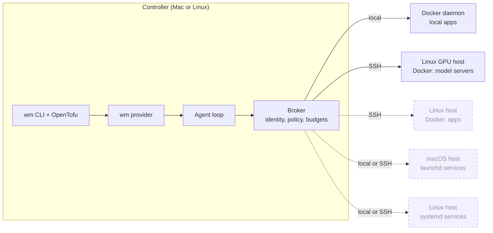

# Workload Manager

Version **0.1.0** (unreleased prototype). See [versioning](docs/versioning.md) and
the [changelog](CHANGELOG.md).

wm manages Docker workloads across hosts from one declarative configuration. You
state what each workload should be: running or stopped, which image or model it
serves, what "ready" means and how much recovery is allowed. wm plans the
difference, brings the workload there and confirms it works before reporting
success. One CLI shows status for every workload and runs plan, apply, start, stop
and restart.

This is an early prototype: it adopts existing containers rather than creating
new ones. Provisioning, image or model replacement and multi-host orchestration
are design goals.

## Why

My containers sprawl across Mac and Linux machines: apps on one host, model
servers on GPU hosts over SSH, each started by hand or a one-off Compose file.
Knowing what should run, what does run and whether it works meant logging into
each host. wm gives each workload one declared intent, one status view and one
reviewed way to change it, without replacing the Docker setups that already work.

## How it works

OpenTofu holds the declaration, plan and state. During apply, a bounded agent
works out how to reach the approved intent using a few scoped tools (observe,
start, stop, wait, logs, probe, restart). Deterministic code checks every action
against identity, policy and budgets, and only an independent readiness probe
can mark the work done. Plans never call the model.



Solid lines are implemented; dashed lines are planned. See
[declarative intent, agentic reconciliation](docs/reconciliation.md) for the
design, safeguards, tradeoffs and alternatives considered.

## Build and verify

Requires Go (see [go.mod](go.mod)), Node >=22.19, npm, Python 3, OpenTofu and SSH,
plus Docker CLI access on each workload host.

```sh
npm ci
make build BIN_DIR=.local/release-check
npm run typecheck && npm test && make test-go
python3 -m unittest discover -s agent/remote -p 'test_*.py'
python3 -m unittest discover -s scripts -p 'test_*.py'
```

Plain `make build` installs into `.local/bin/`, replacing the binaries workload
launchers use; `make build-mac` targets Apple Silicon. macOS and Linux are
supported; Windows is not. See [build targets](docs/development.md#build-targets).

## Try the example

Copy [examples/workloads](examples/workloads/README.md) to a directory outside this
checkout and replace its synthetic identities with the exact containers you want
to adopt. Then, from that directory:

```sh
./wm
./wm plan models/d3
./wm apply models/d3 -v
```

Apply does not ask for confirmation, so review the saved plan first. Destroy stops
an adopted container and keeps the container and its data.

## Documentation

- [Documentation index](docs/README.md)
- [Reconciliation design](docs/reconciliation.md): approach, tradeoffs and alternatives
- [Operator CLI](docs/wm-operator.md): status, lifecycle, saved plans and STATE SYNC
- [Workload configuration](docs/workloads-dx.md): HCL and companion bindings
- [Agent configuration](docs/agent-model.md): YAML profiles and authentication
- [Development](docs/development.md): implementation boundaries and validation
- [Contributor instructions](AGENTS.md)
