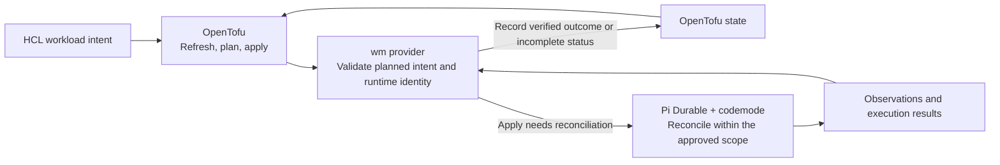
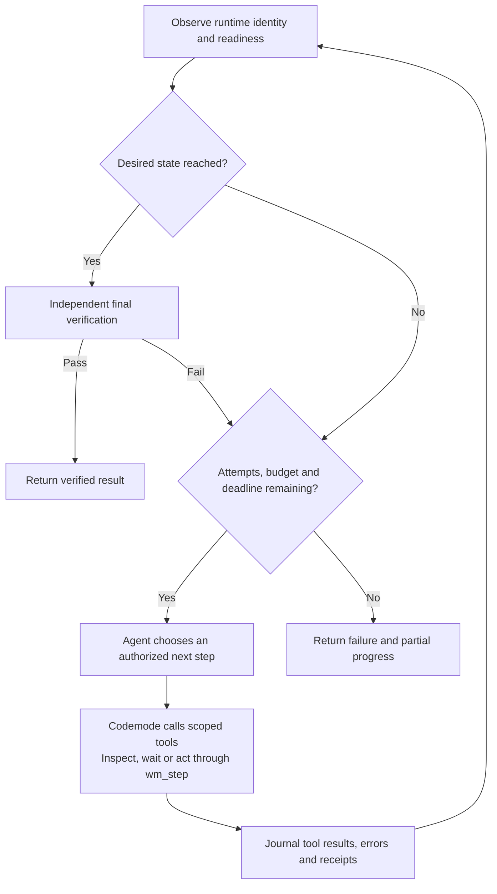

# Workload Manager

Version **0.1.0** (unreleased prototype). See [versioning](docs/versioning.md) and
the [changelog](CHANGELOG.md).

wm uses OpenTofu to declare desired workload state and a Pi Durable/codemode agent
to reconcile it through scoped tools. It manages existing Docker containers and
checks functional readiness, with configurable cloud or OpenAI-compatible models.

This is an early prototype. It currently adopts exact existing containers rather
than provisioning a complete deployment. Docker applications run on the controller's
explicitly pinned daemon; the implemented model adapter uses SSH and vLLM-SR Engine
mode. Other drivers, engine profiles and multi-host orchestration are design work.

## Declarative intent, agentic reconciliation

wm combines OpenTofu's deterministic refresh/plan/apply cycle with a bounded
Pi Durable agent loop inside the provider. OpenTofu owns the resource graph,
planned values and state. During apply, the agent chooses how to reach the approved
outcome using codemode to compose calls to scoped workload tools.



This keeps HCL focused on what the operator wants: running or stopped, the pinned
image/model, readiness requirements and recovery policy. Procedural details such
as inspecting a failed start, waiting for a model to load, checking logs (when
policy allows) and deciding whether an authorized restart could help live inside
reconciliation.
A single workload resource carries that intent; the provider owns the recovery
workflow instead of asking operators to encode each step in HCL or provisioner
scripts. Exact runtime identity and transport still belong in companion bindings.

The inner loop uses fresh observations and tool errors to choose its next step.
Codemode lets the model express that orchestration in JavaScript, while the
deterministic broker checks tool arguments, ownership, policy and budgets before
performing operations. Functional probes establish readiness. The agent's claim
of success alone cannot complete an apply.



Pi Durable preserves execution history and supports resuming interrupted work.
wm's own identity checks, mutation receipts and fresh observation handle ambiguous
external outcomes; a durable journal alone cannot prove that an SSH operation
completed or make an arbitrary external action safe to replay.

Refresh and planning use deterministic observation without calling the LLM.
An apply that finds the workload already converged also skips the agent. The loop
runs during an operation; it does not continuously repair workloads after apply.
The current tools manage captured containers and bounded recovery. Broader recipe
generation, provisioning and runtime replacement remain design goals.

### Tradeoffs

| Benefit | Tradeoff |
|---|---|
| Less HCL for procedural recovery | Complexity moves into the provider, tool contracts, probes and tests. |
| Recovery adapts to observed failures | Agent actions can vary between runs and add model latency, cost and availability requirements. A plan fixes intent and scope rather than every future tool call. |
| Durable execution history aids recovery | Journals, receipts and compatibility need maintenance; interrupted remote outcomes can still require operator inspection. |

Keep intent, ownership and acceptance checks explicit. The agent can choose among
supported actions, but cannot change the requested model, weaken readiness checks
or expand its mutation scope. See [implementation boundaries](docs/development.md)
and the [agent design](docs/workload-manager-pi-codemode-design.md) for details.

## Build and verify

Requires Go (see [go.mod](go.mod)), Node >=22.19, npm, Python 3, OpenTofu, and SSH.
Docker CLI access is required on the controller for local applications and on the
remote host for model workloads. Install dependencies and validate both Go binaries
in a separate output directory:

```sh
npm ci
make build BIN_DIR=.local/release-check
.local/release-check/wm --version
npm run typecheck
npm test
make test-go
python3 -m unittest discover -s agent/remote -p 'test_*.py'
python3 -m unittest discover -s scripts -p 'test_*.py'
```

Build targets:

- `make build`: CLI and provider for the current platform in `.local/bin/`.
- `make build-wm` or `make build-provider`: build one binary.
- `make build-mac`: Apple Silicon binaries in `.local/bin/darwin-arm64/`.
- `make build BIN_DIR=/path/to/bin`: select another output directory.

Plain `make build` replaces the binaries in `.local/bin/` that workload launchers
use. Run it when intentionally installing a reviewed build.

`GO`, `GOCACHE`, `CGO_ENABLED`, `GOOS`, and `GOARCH` can be overridden.
The default build disables cgo. The macOS/Linux CLI uses Unix process and locking
APIs; Windows is not a supported target.

## Try the configuration example

[examples/workloads](examples/workloads/README.md) includes a local Docker app,
an SSH model workload, companion bindings and a development-provider launcher.
Copy it to your own configuration directory and fill in the exact identities of
containers you intend to adopt. The shipped identities are synthetic placeholders.

Keep workload configuration/state separate from this source checkout. The provider
is not published to a registry; the example launcher configures a development
override pointing at your build. The runner currently needs this checkout and its
Node dependencies at runtime. It is not a standalone Go-only installation.

From your configured workload root:

```sh
./wm
./wm plan models/d3
./wm apply models/d3 -v
```

Apply runs without an interactive confirmation. Review the saved plan first.
Recovery runs during an apply, not as a continuous background service. Start/stop,
scoped restart and bounded recovery are implemented; image/model replacement and
container reconstruction are rejected or remain unimplemented. Destroy stops an
adopted container and retains the container and its data.

## Documentation

- [Documentation index](docs/README.md)
- [Operator CLI](docs/wm-operator.md): status, lifecycle, saved plans and STATE SYNC
- [Workload configuration](docs/workloads-dx.md): HCL and companion bindings
- [Agent configuration](docs/agent-model.md): YAML profiles and authentication
- [Development](docs/development.md): implementation boundaries and validation
- [Contributor instructions](AGENTS.md)

## License

[MIT](LICENSE). Dependencies retain their own licenses.
