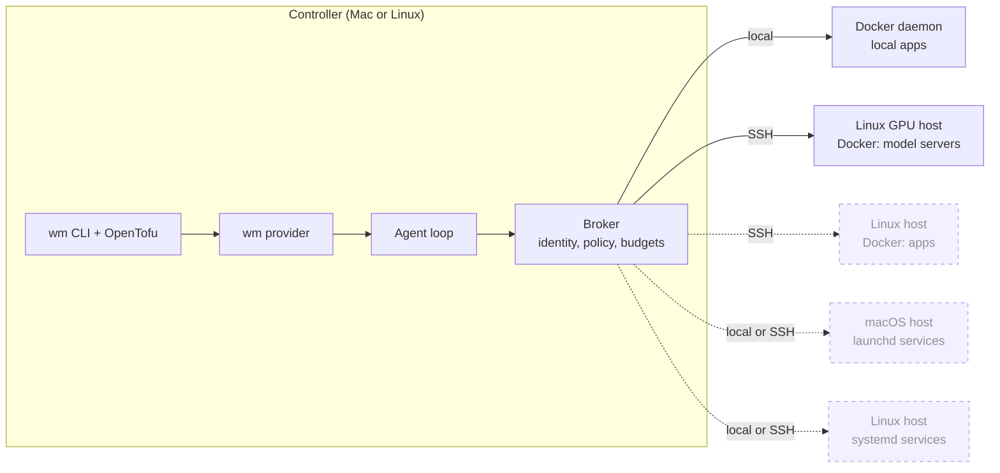
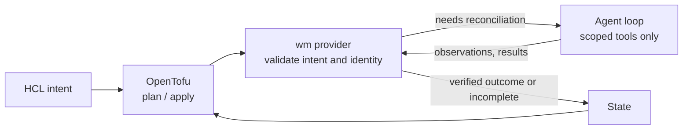
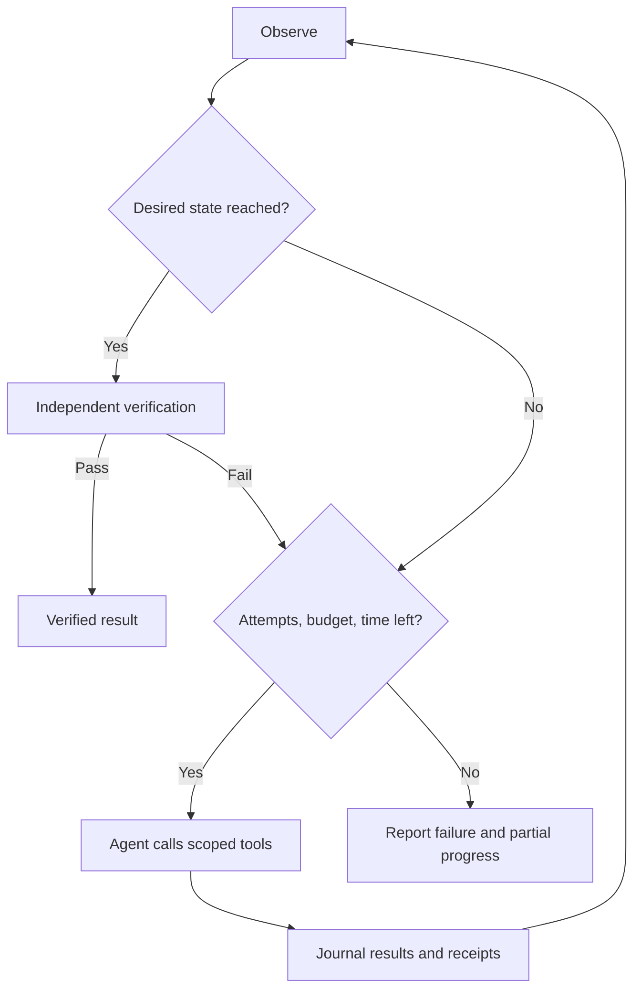

# Workload Manager

Version **0.1.0** (unreleased prototype). See [versioning](docs/versioning.md) and
the [changelog](CHANGELOG.md).

wm manages Docker workloads across hosts from one declarative configuration. You
state what each workload should be: running or stopped, which image or model it
serves, what "ready" means and how much recovery is allowed. wm checks the real
state, plans the difference, brings the workload there and confirms it works
before reporting success. An operator CLI shows status across all workloads and
runs plan, apply, start, stop and restart for each one.

This is an early prototype. It adopts existing containers rather than creating
new ones, and supports start, stop and bounded recovery. Provisioning, image or
model replacement and multi-host orchestration are design goals.

## Why

Containers sprawl. Mine run across Mac and Linux machines: local apps on one
host, model servers on GPU hosts reached over SSH. Each was started by hand or by a
one-off Compose file, and knowing what should be running, what is actually
running and whether it works meant logging into each host. Restarting a model
server that failed to load took several manual checks.

wm gives each workload one declared intent, one place to see its status and one
reviewed path for changing it, without replacing the Docker setups that already
work.

## Hosts and runtimes

wm runs on one controller machine. Every operation goes through the same broker
and a runtime driver, reached either locally or over SSH. Docker is implemented
for apps on the controller's own daemon and for model servers on remote Linux GPU
hosts. Docker apps on other remote hosts and native services managed by launchd
on macOS or systemd on Linux are planned. Bare background shells are deliberately
not a runtime: every workload stays under a real supervisor.



Solid lines are implemented; dashed lines are planned. Each workload is adopted
as one exact runtime identity (container ID, and later unit or service label) on
one host. Coordinating several hosts as a single deployment remains design work.

## Declarative intent, agentic reconciliation

Infrastructure-as-code tools are good at declaring *what* you want and showing a
reviewable plan. They are poor at the procedural part of making a workload
healthy: a model takes minutes to load, a start fails and the logs explain why, a
restart might help or might not. Encoding that judgement in HCL or provisioner
scripts is brittle.

wm splits the problem. OpenTofu owns the declaration, plan and state. During
apply, the wm provider hands the approved intent to a bounded agent
([Pi Durable](docs/workload-manager-pi-codemode-design.md) with codemode) that
decides how to get there using a small set of scoped tools: observe, start, stop,
wait, read logs, check metrics, probe readiness and restart.



The agent chooses steps; deterministic code decides what is allowed and what
counts as done:

- Every tool call passes through a broker that checks container identity,
  ownership, policy and budgets. The agent cannot change the requested image or
  model, weaken readiness checks or touch other containers.
- Success requires an independent readiness probe after the agent finishes. The
  agent saying it succeeded is never enough.
- Refresh and plan never call the model, and an apply that finds the workload
  already converged skips the agent.
- Attempts, commands, model calls and time are capped. Tool results and errors
  are journaled so interrupted work can be inspected and resumed.
- Reconciliation runs only during apply. wm is not a background daemon.



### Tradeoffs

| Benefit | Cost |
|---|---|
| HCL stays short: intent, not recovery procedures | Complexity moves into the provider, tool contracts, probes and tests. |
| Recovery adapts to what actually went wrong | Runs can take different paths and need a model, adding latency, cost and an availability dependency. A plan fixes intent and scope, not every tool call. |
| Plans and state stay deterministic and reviewable | Only apply is agentic; continuous self-healing is out of scope. |
| Durable journals aid recovery after interruption | A journal cannot prove an SSH operation completed; ambiguous outcomes may still need operator inspection. |

### Options considered

| Option | Why not |
|---|---|
| Fully deterministic, with an LLM used at build time to write the configuration rather than at runtime | Verbose: lots of Terraform code, and every recovery edge case must be anticipated and encoded. |
| Fully agentic loop | Too unreliable without extensive prompt tuning and evals. |
| Kubernetes | Too heavy for a handful of hosts and existing containers. |
| A purpose-built subset of Kubernetes | Considered, but too much work to build and maintain. |
| A custom declarative control plane with an agentic data plane | Brainstorming this design led to the current approach. Reusing OpenTofu as the control plane gives the best balance of capability against complexity, build effort and maintenance. |

See [implementation boundaries](docs/development.md) and the
[agent design](docs/workload-manager-pi-codemode-design.md) for details.

## Build and verify

Requires Go (see [go.mod](go.mod)), Node >=22.19, npm, Python 3, OpenTofu and SSH,
plus Docker CLI access on each workload host. Build into a separate directory and
run the checks:

```sh
npm ci
make build BIN_DIR=.local/release-check
.local/release-check/wm --version
npm run typecheck
npm test
make test-go
python3 -m unittest discover -s agent/remote -p 'test_*.py'
python3 -m unittest discover -s scripts -p 'test_*.py'
```

Build targets:

- `make build`: CLI and provider for the current platform in `.local/bin/`. This
  replaces the binaries workload launchers use, so run it only to install a
  reviewed build.
- `make build-wm` or `make build-provider`: build one binary.
- `make build-mac`: Apple Silicon binaries in `.local/bin/darwin-arm64/`.
- `make build BIN_DIR=/path/to/bin`: select another output directory.

`GO`, `GOCACHE`, `CGO_ENABLED`, `GOOS` and `GOARCH` can be overridden; cgo is
disabled by default. macOS and Linux are supported; Windows is not.

## Try the configuration example

[examples/workloads](examples/workloads/README.md) includes a local Docker app, an
SSH model workload, companion bindings and a development-provider launcher. Copy
it to your own configuration directory, outside this checkout, and replace the
synthetic identities with the exact containers you intend to adopt. The provider
is not published to a registry, and the runner needs this checkout and its Node
dependencies at runtime.

From your workload root:

```sh
./wm
./wm plan models/d3
./wm apply models/d3 -v
```

Apply does not ask for confirmation, so review the saved plan first. Destroy stops
an adopted container and keeps the container and its data.

## Documentation

- [Documentation index](docs/README.md)
- [Operator CLI](docs/wm-operator.md): status, lifecycle, saved plans and STATE SYNC
- [Workload configuration](docs/workloads-dx.md): HCL and companion bindings
- [Agent configuration](docs/agent-model.md): YAML profiles and authentication
- [Development](docs/development.md): implementation boundaries and validation
- [Contributor instructions](AGENTS.md)
