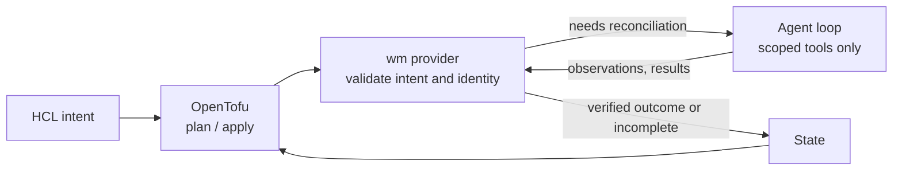
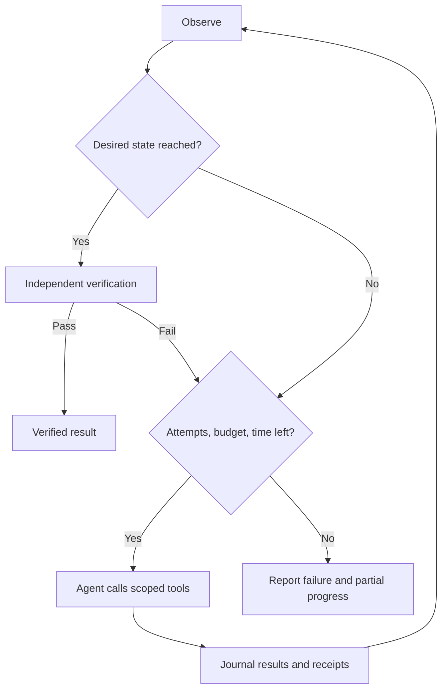

# Design: declarative intent, agentic reconciliation

This describes how the current prototype works and why. The broader target design
is in [proposals](proposals/target-design.md).

## Approach

Infrastructure-as-code tools are good at declaring *what* you want and showing a
reviewable plan. They are poor at the procedural part of making a workload
healthy: a model takes minutes to load, a start fails and the logs explain why, a
restart might help or might not. Encoding that judgement in HCL or provisioner
scripts is brittle.

wm splits the problem. OpenTofu owns the declaration, plan and state. During
apply, the wm provider hands the approved intent to a bounded Pi Durable agent
that uses codemode to compose calls to a small set of scoped tools: observe,
start, stop, wait, read logs, check metrics, probe readiness and restart.

The loop observes actual state, chooses a step, diagnoses failures and repeats
until an independent check passes or a limit is reached. It runs only during
apply. wm is not a background daemon, and existing Docker supervision and
monitoring stay independent.

## Safeguards

The agent chooses steps; deterministic code decides what is allowed and what
counts as done.

- **Scoped tools.** Every call passes through a broker that checks exact
  container identity, ownership, policy and budgets. The agent cannot change the
  requested image or model, weaken readiness checks or touch other containers.
  There is no ambient shell.
- **Independent verification.** Success requires a functional readiness probe
  after the agent finishes. Exit status alone, or the agent claiming success,
  never completes an apply. Application health is distinct from full business
  functionality.
- **No model in planning.** Refresh and plan use deterministic observation only,
  and an apply that finds the workload already converged skips the agent.
- **Untrusted evidence.** Tool results are runtime-validated, bounded and
  sanitized. Logs, model output and remote responses are evidence, never
  instructions or new authority. HTTP probes disable redirects and proxies and
  bound response size and time.
- **Ownership before readiness.** Ownership checks stay separate from engine
  drift: logs and an authorized stop remain available for an exact owned
  container whose model or image no longer matches. Start and restart require the
  declared model and image checks. Desired manifest references are compared with
  RepoDigests, not Docker configuration image IDs.
- **Metrics are supplementary.** Freshness and coverage are tracked; missing
  telemetry is not zero and never proves failure. Prometheus and shared
  monitoring networks are external prerequisites; managing an exporter grants no
  rights over them.

## Budgets, durability and recovery

Each operation has a 30-minute deadline, an 80-command budget and a 40-model-request
budget, preserved across retries by admission checkpoints. Output is capped at
4096 tokens per model request; this is not a total token or monetary budget.
Budget exhaustion terminates outside the tool loop. Restart is limited to one per
operation, after the configured startup grace.

Pi Durable journals tool results and errors, so interrupted work can be inspected
and resumed. A journal alone cannot prove that an SSH operation completed or make
an external action safe to replay, so wm adds its own checks: remote helpers
serialize mutations and store versioned receipts, and every retry re-observes
exact identity first. SSH and waits accept cancellation; an interrupted remote
outcome is treated as unknown, not failed or succeeded.

A kernel lock under `~/.local/state/wm/locks`, keyed by host alias, driver and
container ID, excludes conflicting operations for one controller OS user. It is
not cross-controller fencing.

Destroy stops an adopted container and keeps it and its data. Container
reconstruction and image or model replacement are not implemented.

## Tradeoffs

| Benefit | Cost |
|---|---|
| HCL stays short: intent, not recovery procedures | Complexity moves into the provider, tool contracts, probes and tests. |
| Recovery adapts to what actually went wrong | Runs can take different paths and need a model, adding latency, cost and an availability dependency. A plan fixes intent and scope, not every tool call. |
| Plans and state stay deterministic and reviewable | Only apply is agentic; continuous self-healing is out of scope. |
| Durable journals aid recovery after interruption | A journal cannot prove an SSH operation completed; ambiguous outcomes may still need operator inspection. |

## Options considered

| Option | Why not |
|---|---|
| Fully deterministic, with an LLM used at build time to write the configuration rather than at runtime | Verbose: lots of Terraform code, and every recovery edge case must be anticipated and encoded. |
| Fully agentic loop | Too unreliable without extensive prompt tuning and evals. |
| Kubernetes | Too heavy for a handful of hosts and existing containers. |
| A purpose-built subset of Kubernetes | Considered, but too much work to build and maintain. |
| A custom declarative control plane with an agentic data plane | Brainstorming this design led to the current approach. Reusing OpenTofu as the control plane gives the best balance of capability against complexity, build effort and maintenance. |
