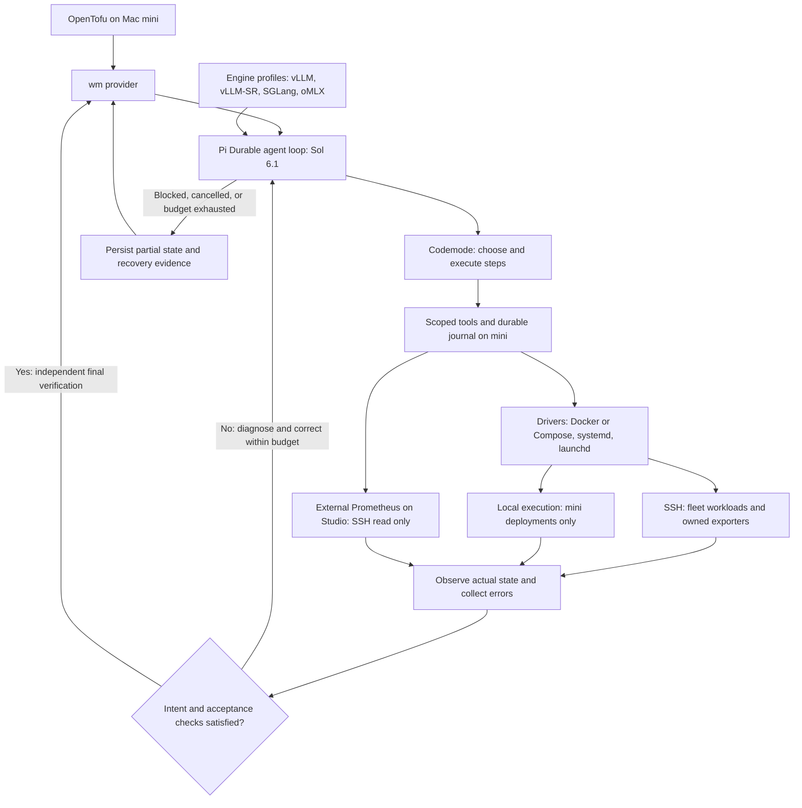

# Target design: OpenTofu with an agent-backed provider

> **Status: proposed target design, beyond the current prototype.** Nothing here is
> a claim that a capability is implemented or tested. For current behaviour see
> [design](../design.md), [configuration](../configuration.md),
> [operations](../operations.md) and [development](../development.md). Host names
> and configurations are illustrative, not a deployment inventory. Deployment
> audit records are kept outside public docs.

Originally drafted 2026-10-30 as an OpenTofu provider spec, then refined to use Pi
Durable with codemode as the reconciliation runtime. It supersedes the earlier
switching-focused spec (in git history).

## 1. Idea and scope

Describe AI model servers and Docker applications in HCL. OpenTofu owns
configuration, dependency planning, state and apply. A small `wm` provider runs a
Pi Durable agent (Sol 6.1, codemode) that inspects the machines, chooses a
practical serving approach and executes scoped tools until the declared outcome is
verified.

The provider exposes intent rather than Docker flags or engine-specific lifecycle
APIs. The agent supplies operational knowledge: how to run a model on a Spark pair,
adapt a recipe to the 5090, diagnose a failed launch or try an MLX variant on the
Studio. Successful implementations become reusable recipe bundles.

The central constraint: **the agent may change the implementation strategy within
the approved change, but may not redefine the requested outcome or expand its
impact.** OpenTofu plans an outcome and a mutation boundary, not a transcript of
future shell commands. Pi is an implementation choice inside the provider, not
another user-facing declarative layer.

Scope is a personal homelab: one operator, explicit host placement, acceptable
planned downtime and visible failures. No always-running AI reconciler or HA
control plane. Batch schedulers, generic VM management and self-management of the
control plane and central monitoring servers are out of scope.

## 2. Environment, control host and transport

Use existing Linux and macOS hosts with explicitly verified identities and runtime
capabilities: Arm accelerator nodes, AMD64 CUDA hosts and Apple Silicon. Capture
actual startup topology, patches, templates, cache layout and immutable artifacts
before adopting a deployment. Never infer launch settings from a model or image
name.

The **Mac mini** is the control host. It runs OpenTofu, the provider, the Pi
runner, credentials, the recipe store and the durable operation journal. It is
distinct from the Mac Studio, which is a remote serving target; inventory lists
`mini` and `studio` as separate identities. Mini hardware and SSH destinations
need verification before implementation. Losing mini interrupts management, not
remote serving.

All operations against arm-01, arm-02, gpu-01 and Studio run over SSH, including
inspection, staging, launch, logs and target-side probes. Local execution is
allowed only for deployments that explicitly name `mini`. Resolve transport from
verified inventory identity, never from the agent's guess or a path that happens to
exist locally. Target paths are remote paths; mini paths are staging paths.

Endpoint acceptance is explicit: a target-side probe verifies the server locally; a
mini-side probe verifies it is usable from the control host. Use SSH tunnels rather
than assuming every API is exposed. Artifact copies may stream through mini; direct
peer transfer is a later optimization.

Prometheus and Grafana stay on Studio, independently provisioned, and are queried
read-only over SSH from mini (see §11). Missing telemetry, an unavailable endpoint
or an old inventory entry never authorizes starting a workload.

## 3. User experience and schema

Start with one resource type, `wm_workload`, and a local fleet inventory file.
Hosts are existing machines, not provider-created infrastructure. One resource is
one logical workload: a model server (including every distributed rank) or an
application container/Compose stack. Changing placement is an update of that
resource so the provider can coordinate a move.

```hcl
terraform {
  required_providers {
    wm = { source = "homelab/wm", version = "~> 0.1" } # proposed namespace
  }
}

provider "wm" {
  inventory = "./fleet.yaml"
  agent     = "gpt-6.1-sol"
}

resource "wm_workload" "glm" {
  kind     = "model"
  driver   = "docker"
  engine   = "vllm"
  name     = "glm"
  hosts    = ["arm-01", "arm-02"]
  model    = "Mia-AiLab/GLM-5.3-Flash-EXL3-TR3-4bpw"
  revision = "25a44fdbf16862a46b7cc9921142c6c81350af2f"
  recipe   = "./recipes/glm-sparks"
  desired  = "running"

  requirements = {
    api            = "openai-chat"
    context_tokens = 32768
    concurrency    = 1
    tool_calls     = true
  }

  change_policy = { downtime = "allowed", rollback = "once", deadline = "45m" }
}

output "glm_endpoint" { value = wm_workload.glm.endpoint }
```

Limits above are illustrative. Import should first reflect the existing
configuration so the first plan is observational. For a new experiment, omit
`recipe`, pin a model revision and host, and optionally add `guidance = "Try
SGLang; favor tool-call correctness over throughput."` Guidance is a preference; it
cannot relax structured requirements.

Changing `model` switches models; changing `hosts` moves the workload; changing
`guidance` or requirements requests a new reconciliation. `desired = "stopped"`
keeps identity and recipe while releasing serving resources. Removing the resource
destroys only owned runtime objects and routes under the kind-specific retention
policy; weights, persistent data and history remain.

Use ordinary `tofu init`, `tofu plan -out=change.tfplan`, `tofu show` and `tofu
apply change.tfplan`. Routine reads and no-op plans need no LLM call. Apply must
honor saved resource values and the provider's captured change boundary.
[OpenTofu plan](https://opentofu.org/docs/cli/commands/plan/)

| Input | Meaning |
|---|---|
| `kind` | `model` or `application`; discriminates requirements |
| `driver` | Optional lifecycle constraint: `docker`, `systemd`, `launchd` |
| `engine` | Optional serving/routing profile; omitted for ordinary applications/exporters |
| `name` | Stable identity; changing it requires replacement |
| `hosts` | Explicit host set; all ranks belong to this resource |
| `model`, `revision` | Model kind only: exact source and pinned revision; local artifacts use a manifest identity |
| `recipe` | Required captured bundle for applications, optional for models; hashed at plan time |
| `desired` | `running` or `stopped` |
| `requirements` | Model API/context/concurrency checks, or named application checks |
| `guidance` | Optional short implementation preferences |
| `change_policy` | Downtime, rollback and total deadline |

Computed outputs: `resolved_driver`, `resolved_engine`, `id`, `endpoint`, `phase`,
`resolved_recipe`, `recipe_digest`, `observed_fingerprint`, `last_operation`,
`last_verified_at` and `repair_token`.

`requirements` is discriminated: model API/context/concurrency fields apply only to
models, named checks only to applications; mismatches are rejected. Changing kind
requires a new resource. Fleet inventory supplies SSH destinations, known-host
aliases, platform, allowed directories, model caches, allowed ports and resource
groups. Credentials come from the SSH agent or protected local files. Provider
settings hold token/tool/time limits and credential references, never workload
blocks.

v0.1 has no public resources for images, containers, mounts, patches, rank
processes or caches; those belong to a workload. Shared artifacts are retained and
never garbage-collected automatically. Host occupancy conflicts fail with a clear
explanation; `-parallelism=1` alone is not a correctness mechanism.

## 4. Driver, engine and transport

These are separate concepts; a driver is not a runtime/engine pair.

| Concept | Responsibility | Values |
|---|---|---|
| Driver | Deterministic lifecycle, ownership, status, logs and supervision | `docker` (including Compose), `systemd`, `launchd` |
| Engine | Serving/routing knowledge, capability discovery and acceptance probes | `vllm`, `vllm-sr`, `sglang`, `omlx`, more versioned profiles |
| Transport | Reach the machine a driver operates on | SSH for fleet hosts; local only for mini deployments |

Ordinary applications and exporters have a driver and no engine. AI routing
workloads are `kind = "application"` with an optional routing profile such as
`vllm-sr`, declaring upstreams and routing checks in their recipe. An engine name
does not determine kind or API: `vllm-sr` can also serve a model. d3 is `kind =
"model"`, `driver = "docker"`, `engine = "vllm-sr"` in Engine mode, and must pass
model identity and inference checks against its actual API. Engine mode belongs to
the pinned recipe and determines the acceptance contract.

Intended combinations, subject to host/build validation:

| Workload | Driver | Engine | Acceptance evidence |
|---|---|---|---|
| d3 on gpu-01 | `docker` | `vllm-sr` (Engine mode) | Exact container/artifact identity and model inference |
| Linux model server | `docker` or `systemd` | `vllm` or `sglang` | Owned runtime, pinned model, required capabilities |
| Native Mac model server | `launchd` | `omlx` | Correct launchd domain, loaded model, functional inference |
| Docker application or Compose stack | `docker` | — | Service identity, dependencies, application checks |
| Host/application exporter | `docker`, `systemd` or `launchd` | — | Owned runtime, direct metrics, collector health |

Keep these as fields on one resource, not a resource type per combination.
Engine-specific flags, mode, endpoints and templates belong in the recipe/profile.

### Selection and plan fidelity

`driver` and `engine` are optional during exploration. Explicit values and a
recipe's pinned selections are hard constraints; conflicts fail validation. With
neither, the agent may choose from the inventory's permitted set during the first
apply, and the saved plan must show the selection as unresolved with its
candidates. Record `resolved_driver`, `resolved_engine`, driver/profile versions
and capabilities in recipe and state, and reuse them after convergence. Changing
them needs an explicit configuration or recipe change and a new plan; a crash does
not authorize switching engines.

Preflight validates OS/architecture, driver availability, artifact format, engine
build and required capabilities. Never invent model-management APIs from an engine
name; validate oMLX and routing engines against the installed version. Captured
distributed recipes keep their executor topology and patches.

### Driver contract

Drivers expose `inspect`, `prepare`, `start`, `stop`, `logs` and `status` through
scoped tools. Each mutation takes the operation scope, expected runtime identity
and idempotency key, returns a durable receipt and can rediscover an interrupted
outcome. Preparation cannot stop serving processes. Start cannot replace a
mismatched live resource; replacement follows the authorized drain/stop/start
sequence.

- **Docker:** identify daemon, project, service and container IDs; preserve named
  data and external networks; validate affected objects before Compose dependency
  expansion.
- **systemd:** identify host, user/system manager, unit name and unit-file hash;
  capture executable/environment references and journal location. Operate only
  owned units in the approved scope; root/system changes need an explicit grant. No
  blanket daemon or host restarts.
- **launchd:** identify host, bootstrap domain, service label and plist hash;
  capture executable, environment and stdout/stderr paths. Never assume an
  interactive login session over SSH; preflight domain and privileges.

Containers stay on their configured Docker daemon; native processes stay under
their declared service manager. Bare background shells and transient SSH sessions
are not drivers. Each process has exactly one lifecycle owner: if systemd launches
Docker, systemd owns it and Docker only observes. Restart policies and agent
recovery need explicit precedence. Shared external services are observed
dependencies, never owned engine processes.

### Engine profiles

Profiles are versioned recipe knowledge, argument conventions, metric mappings and
probes. Start with capabilities such as `serves_model`, `routes_requests`,
`model_discovery`, `chat`, `streaming`, `tools`, `embeddings` and optional model
lifecycle operations, advertising only those verified for the build. Serving
profiles check artifact identity and inference; routing profiles check upstream
reachability and a routed request without weights. Neither assumes OpenAI or
Anthropic APIs. Profiles guide reasoning and verification; they cannot stop a
process, grant host access or bypass the broker.

Implement Docker first. Add systemd and launchd with the same contract before
managing native services such as native Mac exporters or oMLX. This broadens the
design, not the set of services authorized for mutation.

## 5. Architecture



Also available as a [PNG](target-design-flowchart.png) and
[Mermaid source](target-design-flowchart.mmd).

| Component | Responsibility |
|---|---|
| OpenTofu | Configuration, resource graph, plan/apply, state and workspace locking |
| Provider (Go) | Schema, lifecycle callbacks, identity, plan boundary, operation persistence, tool authorization, final verification. No growing library of engine troubleshooting rules |
| Agent (Pi + Sol) | Interpret observations, select/adapt a recipe, call tools, diagnose, choose the next allowed step, explain the result |
| Tool broker | Execute local/remote operations, validate scope, serialize mutations, return receipts. A tool argument is a request, not proof of authorization or success |
| Drivers and profiles | Owned lifecycle operations; serving/routing knowledge and probes |

The runtime keeps serving independently. The provider exits after each OpenTofu
command and cannot be a supervisor.

### Pi Durable runtime

Use `@earendil-works/pi-durable` with its codemode extension and the QuickJS
sandbox from `@earendil-works/pi-codemode`, replacing the earlier plan to build a
custom Responses API loop. Durable codemode resumes scripts from recorded nested
tool results; interrupted external actions still need idempotency and remote
observation. Mark tools replay-safe only when that contract is implemented. Pin
versions and test interrupted SSH operations.
[Pi Durable](https://github.com/earendil-works/pi/blob/main/packages/durable/README.md#code-mode)

Reuse Durable's conversation/task persistence; keep workload manifests and remote
receipts for facts outside the harness. Replayed tool results are evidence from
their original observation time, not fresh state.

Ship two executables:

- `terraform-provider-wm`: Go provider for OpenTofu semantics, read-only
  observation, operation authorization and final state handling.
- `wm-agent`: TypeScript runner embedding Pi Durable, invoked per operation, looping
  observe/act/verify/recover until convergence or a terminal outcome.

They talk over a private pipe/socket. The provider sends the immutable plan
contract, operation ID, prior recipe and observation references; the runner
streams progress and tool requests. stdout is protocol-only; diagnostics go to
stderr. The final response carries outcome, recipe digest and evidence references,
not an authoritative claim of convergence.

Register only workload tools in the session. Disable ambient discovery of user
extensions, project instructions and unrelated tools. Configure the model
explicitly and never fall back silently. Register tools directly in v0.1; MCP is
optional later packaging and needs no permanent daemon.

### Model authentication

The control host can reuse its Codex file-based sign-in through Pi's
`openai-codex` provider with `gpt-6.1-sol` (verified with a live request).
`WM_MODEL_AUTH=codex` selects it; `api` requires `OPENAI_API_KEY`; `auto` prefers
an API key, then Codex. Read the token on demand and never put it in HCL, recipes,
model context, receipts or journals. Codex owns refresh; the bridge supports file
storage only, requires 35 minutes of remaining validity and fails with a refresh
instruction rather than copying refresh tokens. Workload hosts need SSH access, not
model credentials.

## 6. Plan semantics: explicit intent, bounded adaptation

A plan performs deterministic inventory and probes and computes a change contract:

- source runtime identities and fingerprints;
- target hosts, model revision, driver/engine constraints and unresolved candidates;
- recipe digest, or an explicit agent-selected implementation;
- required API/capabilities and acceptance probes;
- owned objects that may be stopped or replaced;
- allowed paths, ports, resources and maximum disruption;
- permitted artifact sources and budgets;
- prior recipe eligible for recovery.

Print a concise summary. Persist the machine-readable contract and hashes in
provider private plan data and verify it survives saved-plan serialization. Known
planned values cannot change at apply; computed outputs may stay unknown. Unknown
required inputs produce a diagnostic, never an agent guess.
[Plan modification](https://developer.hashicorp.com/terraform/plugin/framework/resources/plan-modification)

No downloads, installs, launches, stops, patches or repairs during Read, validation
or planning; plans run repeatedly and may never be applied.

The first exploratory apply authorizes implementation discovery within its
contract. The agent can choose engine flags and support files, but cannot change
the model revision, move hosts, reduce required context, stop an unrelated workload
or disable a requested check. If the request needs that, fail with a proposed HCL
edit; no hidden approval conversation inside a provider.

At apply, refresh inventory and validate the contract before disruption. An
unmanaged process on a port, a changed source runtime or changed bundle bytes
require a new plan. Benign telemetry variation need not invalidate a plan;
insufficient headroom blocks the start. An exact implementation preview can be a
later read-only command.

## 7. Resource lifecycle and drift

### Create and Update

1. Acquire workload and affected-host locks; inspect runtime ownership.
2. Persist an operation ID, intent hash and observations before mutation.
3. Invoke the agent with the contract, recipe/history and bounded tools.
4. Stage images, weights and support files before source disruption.
5. Drain/stop/start or perform a cross-host handoff within policy.
6. Verify with provider-owned probes; return discrepancies to the agent loop (§8)
   until intent is satisfied.
7. Commit only after independent final verification.

A successful agent message is not completion. Models need identity, API shape,
bounded inference and requested streaming/tool tests. Applications need intended
service/configuration identity, dependency readiness and functional checks.
Distributed success needs every rank and the leader endpoint. Liveness alone is
insufficient.

### Read

Inspect owned runtime IDs and manifests and report observations, without the
agent. SSH timeout means unknown, not absent; return a diagnostic without removing
the resource. Remove state only after confirmed absence of the identity and owned
objects. A stopped process may be a workload needing repair.
[Provider Read](https://developer.hashicorp.com/terraform/plugin/framework/resources/read)

A changing computed health field does not reliably schedule an Update. Use an
explicit drift protocol: Read computes a stable `repair_token` from a verified
discrepancy class and runtime identity; the plan modifier plans the converged token
when desired and observed differ. Identical drift yields a stable plan, not churn.
Unknown observations block destructive repair. Successful apply writes the
converged token; failed repair returns an error and honest state. Prove this in
protocol integration tests.

### Delete

Stop only owned runtime IDs on all hosts and remove the owned endpoint mapping.
Retain weights, recipes, persistent data and history. Protected monitoring
infrastructure cannot be destroyed or adopted. Partial or unreachable deletion
returns an error and keeps enough identity to retry. Never report deletion while an
unknown rank may still run.

### Import

Import takes a workload manifest or explicit host/container mapping, and only reads
and captures. Containers stay protected until a later apply authorizes management.
Capture image identity, scripts, patches, mounts and topology; incomplete capture
is not advertised as recreatable. Never adopt by container name alone.

## 8. Reconciliation loop and tools

Each apply runs an iterative loop, not a one-shot launch:

1. **Observe:** journal, live handles, runtime identities and fresh probes on every
   affected host, plus timestamped Prometheus snapshots.
2. **Compare:** exact discrepancies against immutable desired state and acceptance
   criteria.
3. **Decide:** the agent picks the next corrective action from evidence and past
   attempts.
4. **Act:** codemode calls scoped tools; each underlying mutation is journaled.
5. **Verify:** measure the result; feed errors and unmet requirements back.
6. **Commit:** the provider independently checks final evidence and writes state.
   A race or failure here returns to the loop.

Shell errors, failed probes, incomplete downloads, rank failures and recoverable
configuration issues become further turns. The agent may inspect logs, repair a
bundle, resume a transfer, change implementation flags or restart the owned group
within the contract, preserving model/revision, capabilities, hosts and disruption
policy. An OOM may justify a different implementation or cache allocation, never
silently reducing required context or concurrency.

Transient SSH loss triggers bounded reconnection and observation of existing step
handles, never a duplicate start or stopping an unknown peer. Session failure
resumes from the journal and fresh observations; failed attempts stay visible so
the same ineffective repair is not repeated.

Termination is explicit: `Converged`, `Blocked` (needs new authority or a missing
prerequisite), `BudgetExceeded`, `Cancelled` or `RecoveryRequired`. Equivalent
failures without new evidence consume a no-progress budget. Polling a confirmed
live job is waiting, not failure, but still uses the deadline. Diagnostics name the
unmet intent, attempts, live processes and suggested next step. Suggested initial
limits: 80 tool calls, a configurable token cap and the workload's deadline. These
are tunable defaults.

Rollback is one recovery action, not the default. Restoring the source is not
convergence to a different target. If the LLM is unavailable, use the
deterministic single-attempt rollback in §9. Automatic repair after a completed
apply is a separate opt-in watch mode that creates an explicit plan under policy;
it never mutates outside OpenTofu's operation and locking model.

### Tools

Start with `inspect`, `read_bundle`, `logs`, `stage_artifact`, `write_bundle`,
`start_step`, `poll_step`, `probe`, `metrics_snapshot`, `metrics_query` and
`metrics_targets`.

| Tool | Purpose |
|---|---|
| `inspect` | Runtime, hardware, port, filesystem and dependency observations |
| `read_bundle` / `logs` | Bounded diagnostics with secret redaction |
| `stage_artifact` | Download/copy with manifest verification and progress |
| `write_bundle` | Startup scripts, templates, patches, launch definitions, engine config |
| `start_step` / `poll_step` | Operation-scoped local/SSH step with deadline, receipt and durable handle |
| `probe` | Discovery, health and inference checks |
| `metrics_*` | Read-only Prometheus evidence (§11) |

The agent can write launch scripts and adapt engine flags: real agentic
reconciliation, not an engine enum. Avoid a giant `reconcile_everything` tool and
unrestricted SSH shell. Separate diagnostic and mutating tools. The broker enforces
hosts, paths, owned runtime IDs and process/network permissions; remote scripts
need a constrained executor or an explicitly documented trusted-operator mode.
QuickJS isolation does not constrain an exposed remote shell, and prompts are not a
sandbox. Permission claims must match what is enforced. Expose no unrelated MCP
tools or credentials.

Each mutation has an operation-scoped idempotency key and durable receipt. Never
repeat a start because SSH or the model API timed out; poll the handle or inspect
the runtime. Serialize rank-changing steps; parallelize only observation and
staging. A resolved JavaScript promise is not a successful command: normalize
results into typed success/failure records with exit-status checks, including any
MCP error envelopes.

Treat logs, model cards and downloaded scripts as data, never instructions that
expand permissions. Keep decision summaries and tool results, not private
chain-of-thought. Never send API keys or environment dumps to the agent.

### How codemode helps

The agent can inspect both Sparks in one round trip and return only differences
relevant to distributed startup, filter historical 5090 containers and logs, or
summarize oMLX compatibility gaps on Studio. Illustrative script using proposed
tools:

```javascript
const hosts = ["arm-01", "arm-02"];
const results = await Promise.allSettled(hosts.map(host => tools.wm_inspect({ host })));
return results.map((result, i) => ({
  host: hosts[i],
  observation: result.status === "fulfilled" ? result.value : null,
  error: result.status === "rejected" ? String(result.reason) : null
}));
```

The broker attaches the authorized scope out of band; a script cannot grant itself
access with another operation ID. Inspect results are bounded typed records with
references for large logs. Use parallel scripts for inspection or staging and
sequential steps for stop/start and route changes; host-group locks still apply.

### Long tasks and budgets

Weight copies, image preparation and model loading return durable job handles
promptly; a later `poll_step` observes the same job. Never hold a codemode script
open for a 45-minute startup or rely on a detached promise. The journal records
each step before execution with its idempotency key, runtime IDs, progress and
completion. Pi session history is debugging context, never the source of truth
about whether a container exists.

Example: a script starts rank 0, then throws before recording a summary. The next
turn must query the journal and Docker before retrying; blind re-runs could
duplicate or stop a healthy process.

Cancellation revokes permission for new steps; the executor explicitly cancels or
finishes started jobs per contract. Killing Pi does not prove a remote process
stopped. Count actual underlying tool invocations against budgets, not codemode
calls, and bound concurrency, output, turns, tokens and elapsed time. Record tool
evidence before filtering it for the model.

## 9. Durable operations, failure and recovery

OpenTofu state is not an execution journal. Keep a SQLite journal on mini with
operation ID, workload UUID, intent hash, recipe digest, receipts, runtime IDs,
stage and last verification. Store a compact ownership manifest on each host and
recipe bundles in a durable content-addressed directory. Replayed metrics or
observations are historical: after resumption, take a fresh observation before any
corrective mutation, while preserving operation IDs for idempotent mutations.

On interrupted Create, locate the manifest by stable workspace/workload identity
before creating anything. On interrupted Update, reconcile old and new runtime IDs.
Persist identity as early as the SDK permits, return partial state plus errors, and
test crash windows where remote mutation succeeded but state commit did not. An
explicit recovery/import command recovers from the journal when no ID reached
state.

Workspace locking does not stop another workspace or operator using the same GPU.
Add host-group locks and verify ownership at every destructive step. Start with one
workspace. Never steal a stale-looking lock until its operation is proven terminal.
[State locking](https://opentofu.org/docs/language/state/locking/)

Before stopping a known-good workload, save a deterministic recovery recipe;
application rollback also needs data/schema compatibility. If the agent or its API
fails after disruption, the executor may attempt that recipe once without
inference, provided all hosts are reachable and cleanup is verified. Apply still
fails because the target was not reached; state reflects the restored
implementation and pending drift. If recovery fails, keep `RecoveryRequired` with
actionable diagnostics.

OpenTofu has no cross-resource atomic transaction. Keep a move or switch inside one
resource; two resources cannot both assume they may evict each other. Avoid
`create_before_destroy` for an exclusive GPU.

## 10. Recipes and movement

A successful run produces a manifest: artifact revision, image digest/build,
architecture, argv, environment references, file hashes, rank/network settings,
ports, probes and measured memory. Later no-op applies use observation instead of
rediscovery.

To experiment, change requirements/guidance or clone the resource onto a free host
group. A CLI helper may export the resolved recipe into the repository, but apply
never edits HCL. Pin exported bundles. Record agent model, prompt/tool schema
versions and provenance; a model alias does not guarantee reproducibility.

For the Sparks, preserve `mp` topology and patches during capture, replace `/tmp`
dependencies with durable files and avoid circular worker-before-leader readiness
checks. For the 5090, verify prior tuning artifacts are complete before reuse.

Moving to oMLX needs an explicitly compatible artifact. The agent may recommend an
MLX variant but cannot substitute it for the pinned model; change the declaration
and plan again. A future `model_family` could allow declared equivalents.

Cross-host moves prepare and validate the target before withdrawing the source when
capacity permits. Same-host switches stage first, then accept measured downtime.
Memory checks distinguish 5090 VRAM from Spark/Studio unified memory and include KV
cache, runtime overhead and OS headroom.

## 11. Actual state: metrics, runtime evidence and probes

Prometheus is a first-class read-only input to every cycle. SSH establishes current
identity and ownership; probes establish the requested capability. No single source
substitutes for the others.

| Evidence | Establishes | Cannot establish alone |
|---|---|---|
| SSH/runtime inspection | Exact process, image, mounts, ports, ranks, exits | Successful inference or historical performance |
| Prometheus | Pressure, demand, latency, throughput, collector health, trends | Ownership, safe deletion or readiness after a change |
| Active probes | Current model/API/capability behaviour | Long-term stability or capacity under load |

Mini queries Studio's Prometheus over SSH (a bounded HTTP query to
`127.0.0.1:9090` or a managed loopback tunnel), preserving its loopback binding.
Inventory maps `studio` to the existing label `node="mac"`, never mini; mini
monitoring is a separate future target. Never migrate monitoring or change scrape
configuration as a side effect.

### Metrics tools

- `metrics_snapshot(workload, window)`: curated host/engine signals with freshness
  and coverage.
- `metrics_query(workload, expression, start, end, step)`: bounded PromQL, scoped by
  a parsed selector policy to the workload's targets, with limits on time, range,
  points and series; truncation is reported.
- `metrics_targets(workload)`: target presence, scrape health, last scrape and
  collector errors.

Use `/api/v1/query`, `/query_range` and `/targets`, preserving warnings and errors.
[Prometheus HTTP API](https://prometheus.io/docs/prometheus/latest/querying/api/)
Each result includes expression, evaluation time, source sample ages, window, label
mapping, units, coverage, warnings and evidence ID. Evaluation time does not prove
source freshness; check source timestamps and scrape metadata. Classify results as
fresh, stale, missing, unsupported or error, and never coerce missing or NaN to
zero. PromQL lookback can return old samples.
[Query semantics](https://prometheus.io/docs/prometheus/latest/querying/basics/)

Derive scrape intervals and metric semantics from the deployment. Freshness can
start at two scrape intervals plus 15 seconds. Use SSH/probes right after a
mutation; faster polling cannot create samples. Useful signals: collector success,
host memory, GPU memory pressure, queue depth, token throughput, cache occupancy,
preemptions and latency. Verify units and counter/gauge type; empty idle histograms
mean no observations, not zero latency. Illustrative selectors:

```promql
node_memory_MemAvailable_bytes{job="node",node=~"arm-01|arm-02"}
vllm:num_requests_waiting{job="vllm",instance="arm-01:8888"}
rate(vllm:generation_tokens_total{job="vllm",instance="arm-01:8888"}[5m])
increase(vllm:num_preemptions_total{job="vllm",instance="arm-01:8888"}[5m])
```

### How metrics change decisions

Capture a pre-change baseline, recent trends during recovery and post-change
evidence, correlated with runtime ID/start time. A reused endpoint must not blend an
old deployment's history into new acceptance evidence. Counter resets and label
changes stay explicit.

- Queue growth with continuing throughput suggests load: check concurrency and
  latency before restarting a productive server.
- Queue growth with stalled throughput suggests a stall: verify runtime/logs and
  probe before repair.
- High cache occupancy with rising preemptions suggests pressure: adjust within
  declared requirements, then measure.
- `up=0` with successful inference suggests a monitoring problem; never restart a
  healthy model to fix a scrape.
- High memory on a loaded Spark or low GPU use on an idle one is not failure.

Metrics guide hypotheses, never permission. Destructive corrections still need
current SSH ownership checks and the contract. Prometheus outage means degraded
observability: continue with inspection and direct probes, and report any
telemetry-dependent acceptance criterion as unverified.

Define acceptance against requested behaviour, not utilization thresholds. Default
readiness needs direct inference and correct model identity; an optional
stabilization window can require fresh scrapes and no restart/error regression.
Latency/throughput acceptance needs a declared test load. Report verified
capabilities and telemetry coverage.

Test stale-but-present samples, missing collectors, Prometheus down with healthy
serving, overloaded-but-progressing queues, idle histograms, model swaps on one
port, counter resets and resumed sessions with old snapshots; none may cause an
unjustified restart or false convergence. Validate against the real schema.

## 12. Docker applications

`kind = "application"` shares placement, desired state, change policy, history and
the reconciliation loop with models, but omits `model`/`revision` and requires a
captured recipe. The first application driver is Docker/Compose on one host;
distributed scheduling and cron/batch jobs are deferred.

An application is one container or a cohesive Compose stack. Service names,
dependency graph, pinned images, mounts, networks and probes live in the recipe.
Examples: a web/worker/database stack, a memory service, a dashboard and a separately
owned exporter. Each needs explicit identities, persistent-data policy and
functional probes; container presence proves neither ownership nor readiness.

```hcl
resource "wm_workload" "dashboard" {
  kind          = "application"
  driver        = "docker"
  name          = "dashboard"
  hosts         = ["studio"]
  recipe        = "./recipes/dashboard"
  desired       = "running"
  requirements  = { checks = ["application-ready", "data-source-ready"] }
  change_policy = { downtime = "allowed", rollback = "once", deadline = "10m" }
}
```

Check names refer to versioned recipe probes whose endpoint, expected response and
execution location are captured and verified. `endpoint` is optional;
`endpoints` is a named map and may be empty for workers.

### Ownership, adoption and transport

Mini operates Studio Docker over SSH with the configured user and Docker
context/socket. Verify daemon identity and Colima availability first; never operate
mini's daemon through inherited environment. Bind mounts are Studio paths; named
volumes belong to that daemon. Colima is an external prerequisite: report it down
rather than recreating the VM.

Capture every Compose file in order, profiles, project name, runtime IDs, image
digests, secret references, mounts and shared dependencies, plus required support
assets. Never put resolved secrets in HCL, model context or logs; keep source paths
and credentials in private configuration. Adoption records exactly which objects
are owned and must not recreate healthy services to attach labels. Partial-project
adoption uses explicit service IDs and cannot run project-wide `down` or remove
orphans. Prefer one resource per application project.

Unrelated services can coexist. Exclusion covers conflicting ports, GPU claims,
owned objects and shared mutable dependencies. Shared data and networks have one
lifecycle owner; consumers gain no deletion rights.

### Convergence and repair

Convergence needs declared services with intended image/configuration, ready
dependencies and passing application checks. A worker may need a queue round-trip
instead of HTTP. Prefer read-only checks; synthetic writes need a declared test
namespace and cleanup. Use Compose dependency conditions and health checks for
startup; running is not readiness, and OpenTofu `depends_on` does not verify
readiness. [Compose startup order](https://docs.docker.com/compose/how-tos/startup-order/)

Repair the smallest failing owned scope, then verify the whole application: a web
error should not restart the database. A missing external dependency is a blocked
prerequisite, not permission to provision it. The loop may fix captured
configuration, restore an owned file, restart an unhealthy owned service or apply a
planned update. It may not change versions, reset databases, remove data or weaken
probes. Recipe edits affecting identity need a new plan.

Application actual state adds service identity, Docker health/restart/OOM, memory
limits and pressure, dependency readiness and functional checks. Infrastructure
metrics (for example Langfuse's) can explain a failure but do not prove trace
ingestion; queue/latency signals need verified mappings, and not every container
exports metrics.

### Persistent data and upgrades

Recipes declare data locations, ownership, retention, migration behaviour and
recovery. `stopped` retains identity, configuration and data. Destroy removes owned
containers and exclusively owned unused networks, keeping volumes, bind data,
secrets and backups. Automatic recovery never uses volume prune, `down -v`,
anonymous-data recreation or broad `--remove-orphans`.
[Compose down](https://docs.docker.com/reference/cli/docker/compose/down/)

Updates that can migrate data need a declared upgrade path, consistent backup,
restore procedure and approved contract. After an interrupted SSH result, check the
recorded migration outcome before retrying. Image rollback does not undo a
migration; if backward compatibility is unproven, stop with evidence rather than
run an old binary on changed data.

Moving a stateful application needs an explicit procedure: stage, quiesce writes,
consistent copy, restore and verify on target, cut over clients, fence the source.
v0.1 rejects stateful cross-host moves unless the recipe provides and validates
that procedure. Stateless moves can use target-first handoff.

### External Prometheus, wm-managed exporters

**wm never provisions, adopts, upgrades, stops, deletes or repairs Prometheus.**
Its server, storage, scrape/rule configuration and shared monitoring networks, and
Grafana, stay externally managed. wm reads them and proposes target/rule changes to
the separate ops workflow.

**Exporters may be wm-managed** as independent applications: Docker node/GPU and
application exporters. Embedded vLLM/SGLang metrics stay part of their model
recipes. Native launchd exporters need a validated native-service driver; never
move them into Docker, which changes what machine they measure.

Each exporter has an ownership manifest, recipe and acceptance checks, with only
the permissions needed for collection; Docker socket access is not read-only access.
Restarting, upgrading or deleting an exporter never touches the observed
application. Declaring that application as a dependency grants observation, not
mutation. Applications must work without their exporter.

Exporter acceptance uses SSH runtime checks, direct `/metrics` requests from the
right network namespace, expected metric families and collector-success signals;
HTTP 200 alone is insufficient. Prometheus scrape success is supplementary. With
Prometheus down, report `exporter-ready / scrape-verification-unavailable`, leave
any requested scrape gate unverified and still allow scoped exporter recovery. A
collector failing because the observed application is down never authorizes
restarting it; missing telemetry never means restart.

An exporter may share a Compose project with a protected Prometheus server. Import
identifies only the exporter service and runtime IDs. Allow only service-scoped
operations with dependency expansion disabled and the affected-object set checked
against protection rules; never project-wide `down`, orphan cleanup or network
deletion. Until the ops workflow extracts the exporter, use a captured
exporter-only bundle referencing existing external networks and preserve the
existing service identity without a duplicate container. If that cannot be shown,
block adoption. Shared Compose files stay externally owned and immutable to wm.

Protect concrete server IDs, configuration/data paths, shared networks and
project-wide operations rather than blanket-denying an exporter whose project
contains Prometheus. Authorization applies to generated scripts too. A dedicated
exporter recipe directory may be wm-owned without granting access to scrape/rule
or shared monitoring files.

## 13. Serving, notifications and state

OpenTofu reconciles when invoked; this is not a background controller. Docker and
native supervisors keep serving after apply, and existing monitoring surfaces
failures between applies. Scheduled read-only plans may detect drift; automated
disruptive applies are a separate opt-in feature.

Return direct endpoints first. Optional stable aliases use a separate small gateway
with persisted routes, independent of the provider and model API. Route updates
require successful target probes; draining must acknowledge before source stop.
Routes stay under their workload's ownership. No inferred protocol translation or
request replay.

Propose operation-status, intended-availability, functional-probe and failure
notifications to the ops workflow. A status exporter reads journal/manifest
observations and never calls the agent. Provider failures appear in OpenTofu
diagnostics and the monitoring trail. Preserve vLLM/SGLang job labels, test one
notification destination, and do not alert on intentionally stopped workloads.

State holds only bounded identities, hashes, endpoints and summarized observations;
detailed logs live elsewhere. Sensitive attributes do not make state secret
storage; protect state/plan files deliberately.
[Sensitive state](https://opentofu.org/docs/language/state/sensitive-data/)

## 14. Prototype and acceptance gates

Build the runner independently of OpenTofu first, with a saved operation-contract
fixture and a fake executor. Prove tool registration, model access, cancellation
and output normalization before real mutations. Then build the smallest vertical
slice on the idle 5090:

1. Read-only inventory through codemode; a provider with one resource,
   deterministic Read, import and agent transport.
2. One pinned model launch with a durable recipe and independent inference check.
3. Repeated plan/apply is a no-op with no agent call or engine restart.
4. A failed or removed owned process produces an Update plan; an unreachable host
   causes no replacement or deletion.
5. A bad launch flag and failed inference check are diagnosed and corrected without
   manual intervention.
6. A switch stages first, honours the declared model/capabilities and fails honestly
   after rollback.
7. Kill the provider (or fail a script) after a remote start but before state
   commit; retry recovers the same identity without a duplicate.
8. Out-of-scope hosts, unowned exporter stops and Prometheus changes are rejected by
   the executor, not just the prompt. An owned exporter is repaired with Prometheus
   unavailable, leaving the observed application untouched.
9. A saved plan applied after a recipe or identity change fails before disruption.
10. Cancel a long operation; live handle, termination/resume rules and journal
    agree.
11. From mini, every non-mini action uses SSH, including Studio deployments.
12. Partial Create/Delete state handling with the selected OpenTofu/SDK versions.

Application gates, using disposable fixtures before live Langfuse or Hindsight
data:

- Import a disposable application without recreation; repeated plan/apply is a
  no-op.
- On Studio via SSH from mini, with one dependency and persisted test data, repair
  a failed web service without restarting the healthy dependency.
- Application probes can fail while Docker reports running; the agent recovers
  without weakening checks.
- Interrupt an update after container replacement; resumption finds the replacement
  without duplicating it.
- Stop/destroy retains test data; a failed migration never triggers blind image
  rollback or data reset.
- Reject plans, imports or tool calls targeting Prometheus server, storage,
  scrape/rule configuration or shared networks, including via a shared exporter
  project.
- Adopt/replace the Langfuse exporter without changing Prometheus IDs, shared
  configuration, networks or history.
- Simulated missing metrics leave healthy applications alone; telemetry-dependent
  acceptance is reported unverified.
- Verify remote Docker context identity, port conflicts and coexistence.

Driver/engine gates: constraint conflicts, unsupported OS/format combinations,
no-op reuse of resolved choices, crash recovery by exact identity, native
service-manager domain selection over SSH and prevention of double supervision. A
routing engine passes routed-request checks without weights; a non-AI application
works with no engine.

Then add the Spark pair (including rank loss during startup), the Studio/oMLX trial,
compatible model movement, application recovery and tested notification delivery.
Never use the active Spark deployment as the first destructive target.

## 15. Tradeoff and decision

This removes much hand-built orchestration and engine-specific adapter logic. HCL
stays small, and the agent can handle unusual patched engines and new recipes. The
cost is probabilistic troubleshooting, dependence on a model service during
changes, and plans that describe bounded outcomes rather than every command.

The hard part is a small set of deterministic contracts: ownership, plan fidelity,
operation recovery, drift scheduling and evidence of success. Keep that kernel
reliable and let the agent handle changing operational details. Pi's value is
removing agent-loop plumbing while that kernel stays easy to reason about.

**Recommendation:** prototype as an alternative provider, starting with single-host
experiments. Advance only if the gates show that an interrupted or unsuccessful
agent run stays understandable and recoverable. Existing workloads and monitoring
supply the test cases; they need no redesign first.
