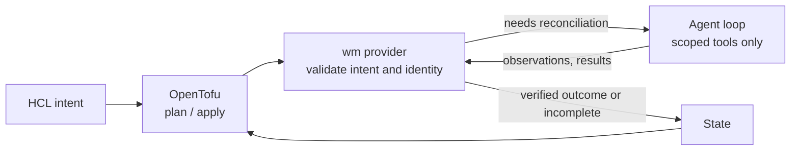
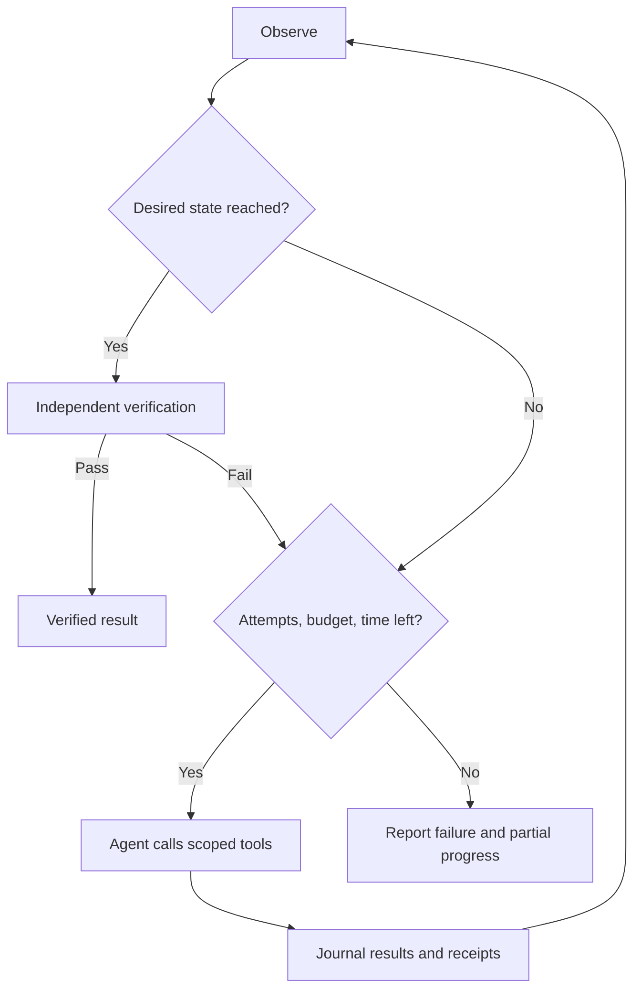

# Declarative intent, agentic reconciliation

Infrastructure-as-code tools are good at declaring *what* you want and showing a
reviewable plan. They are poor at the procedural part of making a workload
healthy: a model takes minutes to load, a start fails and the logs explain why, a
restart might help or might not. Encoding that judgement in HCL or provisioner
scripts is brittle.

wm splits the problem. OpenTofu owns the declaration, plan and state. During
apply, the wm provider hands the approved intent to a bounded agent
([Pi Durable](workload-manager-pi-codemode-design.md) with codemode) that decides
how to get there using a small set of scoped tools: observe, start, stop, wait,
read logs, check metrics, probe readiness and restart.

## Safeguards

The agent chooses steps; deterministic code decides what is allowed and what
counts as done:

- Every tool call passes through a broker that checks container identity,
  ownership, policy and budgets. The agent cannot change the requested image or
  model, weaken readiness checks or touch other containers.
- Success requires an independent readiness probe after the agent finishes. The
  agent saying it succeeded is never enough.
- Refresh and plan never call the model, and an apply that finds the workload
  already converged skips the agent.
- Attempts, commands, model calls and time are capped. Tool results and errors
  are journaled so interrupted work can be inspected and resumed.
- Reconciliation runs only during apply. wm is not a background daemon.

## Tradeoffs

| Benefit | Cost |
|---|---|
| HCL stays short: intent, not recovery procedures | Complexity moves into the provider, tool contracts, probes and tests. |
| Recovery adapts to what actually went wrong | Runs can take different paths and need a model, adding latency, cost and an availability dependency. A plan fixes intent and scope, not every tool call. |
| Plans and state stay deterministic and reviewable | Only apply is agentic; continuous self-healing is out of scope. |
| Durable journals aid recovery after interruption | A journal cannot prove an SSH operation completed; ambiguous outcomes may still need operator inspection. |

## Options considered

| Option | Why not |
|---|---|
| Fully deterministic, with an LLM used at build time to write the configuration rather than at runtime | Verbose: lots of Terraform code, and every recovery edge case must be anticipated and encoded. |
| Fully agentic loop | Too unreliable without extensive prompt tuning and evals. |
| Kubernetes | Too heavy for a handful of hosts and existing containers. |
| A purpose-built subset of Kubernetes | Considered, but too much work to build and maintain. |
| A custom declarative control plane with an agentic data plane | Brainstorming this design led to the current approach. Reusing OpenTofu as the control plane gives the best balance of capability against complexity, build effort and maintenance. |

See [implementation boundaries](development.md) and the
[agent design](workload-manager-pi-codemode-design.md) for details.
