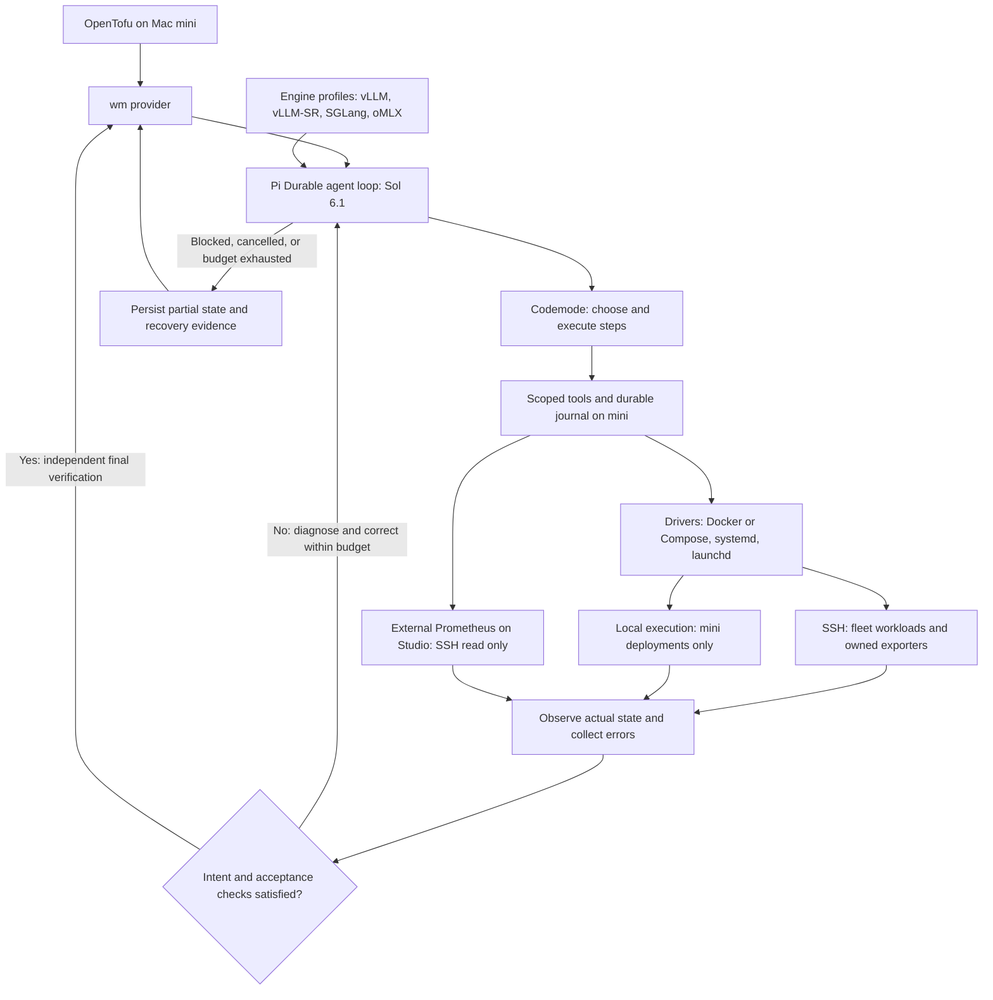

# Workload Manager: OpenTofu with an agent-backed provider

> Implementation note: this is the broader design target. For the implemented HCL runtime/model blocks, companion bindings and current limits, see [configuration](workloads-dx.md) and [status](development.md).

**Status:** Alternative design, v0.1 · **Date:** 2026-10-30

## 1. Idea

Describe AI model servers and Docker applications in HCL. OpenTofu owns configuration, dependency planning, state and apply. A small `wm` provider invokes **GPT-6.1 Sol** to inspect the machines, choose a practical serving approach, and execute tools until the declared outcome is verified.

The provider exposes intent rather than Docker flags or engine-specific lifecycle APIs. Sol supplies the operational knowledge: how to run a particular model on a Spark pair, adapt a serving recipe to the 5090, diagnose a failed launch, or try an MLX variant on the Studio. Successful implementations become reusable recipe bundles.

The central constraint: **the agent may change the implementation strategy within the approved change, but may not redefine the requested outcome or expand its impact.** OpenTofu plans an outcome and a mutation boundary, not an exact transcript of future shell commands.

This is a separate proposal from [the previous spec](workload-manager-spec.md). It targets a personal homelab: one operator, explicit host placement, acceptable planned downtime, and visible failures. No always-running AI reconciler or HA control plane is required.

## 2. Target environment and prerequisites

Use existing Linux and macOS hosts with explicitly verified identities and runtime
capabilities. Hardware can include Arm accelerator nodes, AMD64 CUDA hosts and
Apple Silicon. Capture actual startup topology, patches, templates, cache layout
and immutable artifacts before adopting a deployment. Do not infer launch settings
from a model or image name.

Prometheus is independently provisioned. Missing telemetry, an unavailable endpoint
or an old inventory entry does not authorize starting a workload. Public host names
and configurations below are examples, not a live inventory. The first implementation
and its narrower schema are documented in [configuration](workloads-dx.md).

## 3. User experience

Start with one resource type, `wm_workload`, and a local fleet inventory file. Hosts are existing machines, not infrastructure created by this provider. One resource represents one logical workload: a model server (including every distributed rank) or an application container/Compose stack. Changing its placement is an update of that resource so the provider can coordinate a move.

Illustrative HCL for the proposed provider; this provider is not yet published:

```hcl
terraform {
  required_providers {
    wm = {
      source  = "homelab/wm" # proposed namespace
      version = "~> 0.1"
    }
  }
}

provider "wm" {
  inventory = "./fleet.yaml"
  agent     = "gpt-6.1-sol"
}

resource "wm_workload" "glm" {
  kind      = "model"
  driver    = "docker"
  engine    = "vllm"
  name      = "glm"
  hosts     = ["arm-01", "arm-02"]
  model     = "Mia-AiLab/GLM-5.3-Flash-EXL3-TR3-4bpw"
  revision  = "25a44fdbf16862a46b7cc9921142c6c81350af2f"
  recipe    = "./recipes/glm-sparks"
  desired   = "running"

  requirements = {
    api            = "openai-chat"
    context_tokens = 32768
    concurrency    = 1
    tool_calls     = true
  }

  change_policy = {
    downtime    = "allowed"
    rollback    = "once"
    deadline    = "45m"
  }
}

output "glm_endpoint" {
  value = wm_workload.glm.endpoint
}
```

The context/concurrency above are illustrative requested limits, not claims about a real serving configuration. Import should first reflect the existing configuration so the first plan is observational.

For a new experiment, omit `recipe`, specify a pinned model revision and host, and optionally provide `guidance = "Try SGLang; favor tool-call correctness over throughput."` Sol selects and materializes the serving implementation. `guidance` is a preference; it cannot relax structured requirements.

Changing `model` switches models. Changing `hosts` moves the workload. Changing `guidance` or requirements requests a new reconciliation. Setting `desired = "stopped"` retains its identity and recipe while releasing serving resources. Removing the resource destroys only owned runtime objects and routes under the kind-specific retention policy; weights, persistent application data and history remain.

Use ordinary commands:

```sh
tofu init
tofu plan -out=change.tfplan
tofu show change.tfplan
tofu apply change.tfplan
```

Routine reads and no-op plans should not need an LLM call. OpenTofu supports saved plans; the apply must honor the saved resource values and the provider's captured change boundary. [OpenTofu plan documentation](https://opentofu.org/docs/cli/commands/plan/)

## 3.1 Docker applications are first-class workloads

`wm_workload` supports `kind = "model"` and `kind = "application"`. A model requires `model` and `revision`; an application omits those and requires a captured recipe. Both share placement, desired state, change policy, operation history and the Pi Durable reconciliation loop. Changing kind requires a new resource identity. The first application driver implementation is Docker/Compose on one host, with systemd and launchd defined in §4.1; distributed arbitrary application scheduling and cron/batch jobs remain deferred.

An application is one container or a cohesive Compose stack. Internal service names, dependency graph, pinned image identities, mounts, network attachments and probe definitions live in its recipe, keeping HCL small. Compose is the runtime description; the agent diagnoses and repairs failures while preserving declared intent.

Examples of application groups include a web/worker/database stack, a memory service,
a dashboard and a separately owned exporter. Each group needs explicit identities,
persistent-data policy and functional probes. Container presence alone establishes
neither ownership nor readiness. Capture every Compose file and required support
asset before adoption. Keep source paths, credentials and deployment audit records
in private configuration rather than public design documents.

Illustrative future declaration after capturing an application recipe:

```hcl
resource "wm_workload" "dashboard" {
  kind    = "application"
  driver  = "docker"
  name    = "dashboard"
  hosts   = ["studio"]
  recipe  = "./recipes/dashboard"
  desired = "running"

  requirements = {
    checks = ["application-ready", "data-source-ready"]
  }

  change_policy = {
    downtime = "allowed"
    rollback = "once"
    deadline = "10m"
  }
}
```

Check names refer to versioned recipe probes whose actual endpoint, expected response and execution location are captured and verified, not guessed here. `requirements` is a discriminated object: model API/context/concurrency fields apply only to models; named application checks apply only to applications. Reject mismatched fields. `endpoint` is optional for applications; `endpoints` is a named map and may be empty for workers.

### Ownership, adoption and transport

The mini operates Studio Docker through SSH using the explicitly configured Studio user and Docker context/socket. Verify daemon identity and Colima availability first; do not accidentally operate mini's Docker daemon through inherited environment settings. Bind-mount paths are Studio paths; named volumes belong to that daemon. Colima is an externally managed host prerequisite: if it is down, report the host-runtime failure rather than recreating the VM.

Capture every Compose file in order, selected profiles, project name, runtime IDs, image digests, secret references, mounts and shared dependencies. Never dump resolved secret environment values into HCL, model context or logs. Explicit adoption records which exact objects are owned; the first imported plan must not recreate healthy services just to attach labels. Partial-project adoption uses explicit service IDs and cannot execute project-wide `down` or remove orphans. Prefer one resource for an entire candidate application project.

Unrelated services can coexist on Studio. Resource exclusion is scoped to conflicting ports, GPU claims, owned objects and shared mutable dependencies rather than making every application exclusively own the host. Shared data and networks have one lifecycle owner; dependencies consume them without gaining deletion rights.

### Convergence and dependency-aware repair

For an application, convergence requires the declared services to exist with the intended image/configuration, necessary dependencies to be ready, and application-level checks to pass. A worker may need a queue round-trip or bounded job check instead of an HTTP probe. Read-only checks are preferred; any synthetic writes must use a declared test namespace and cleanup procedure.

Use Compose dependency conditions and service health checks for startup sequencing. Running alone is not readiness; dependencies with `service_healthy` wait on their health checks. OpenTofu `depends_on` orders different resources but does not continuously verify application readiness. [Compose startup order](https://docs.docker.com/compose/how-tos/startup-order/)

Sol inspects the failing service, its dependencies, logs and metrics; repairs the smallest affected owned scope, then verifies the whole application's acceptance checks. A web-service error should not automatically restart its database. A missing external dependency is a blocked prerequisite, not permission to provision it. Repeated failing probes feed back into the same agent loop under the declared budgets.

The loop may correct a captured configuration error, restore a missing owned file, restart an unhealthy owned service or apply a planned image/configuration update. It may not silently change application versions, reset databases, remove user data or weaken probes to obtain a passing result. Recipe edits affecting declarative identity require a new plan; permitted implementation corrections must stay inside the saved contract.

### Persistent data and upgrades

Application recipes declare data locations, ownership, retention, migration behavior and a recovery procedure. `desired = "stopped"` stops serving while retaining identity, configuration and data. Destroy removes owned containers and only exclusively owned unused networks, retaining named volumes, bind data, secrets and backups. No volume prune, `down -v`, anonymous-data recreation or broad `--remove-orphans` in automatic recovery. Compose's volume/deletion behavior makes these explicit retention rules necessary. [Compose down](https://docs.docker.com/reference/cli/docker/compose/down/)

Before an update that can migrate schema or persistent data, require a declared compatible upgrade path, application-consistent backup/checkpoint, restoration procedure and operator-approved change contract. Retrying a migration after an interrupted SSH result requires checking its recorded outcome first. Rolling back the container image does not undo a database migration; if backward compatibility is unproven, stop with recovery evidence rather than start an old binary against changed data.

Moving a stateful application requires an explicit data-migration plan: stage images/configuration, quiesce writes, create a consistent copy, restore and verify on target, cut over clients, and keep the source fenced from writes. A generic host-field change must not copy a live database directory and call it a move. v0.1 rejects cross-host moves of stateful applications unless the recipe provides and validates that procedure. Stateless moves can use target-first handoff when ports/dependencies permit.

### External Prometheus, wm-managed exporters

**Prometheus must not be provisioned, adopted, upgraded, stopped, deleted or repaired by wm.** Its server, storage, scrape/rule configuration and shared monitoring networks remain externally managed. Grafana stays external too. wm consumes this infrastructure read-only and proposes target/rule changes to the separate ops workflow.

**Exporters may be managed by wm** as independent `kind = "application"` workloads. Candidates include Docker-based node/GPU and application exporters. Embedded vLLM/SGLang metrics remain part of their model-serving recipes. Native launchd exporters require a separately validated native-service adapter; do not silently move them into Docker, which would change what machine they measure.

Give each exporter an explicit ownership manifest, recipe and acceptance checks. Its permissions are limited to the host/app interfaces needed for collection; access to a Docker socket must not be mistaken for technically read-only API access. Restarting, upgrading or deleting an exporter never restarts or deletes the observed application. Declaring an observed application as a dependency grants observation, not mutation rights. An application must remain operable when its exporter is absent.

Exporter acceptance uses SSH runtime checks, direct `/metrics` requests from an appropriate network namespace, valid expected metric families and collector-success signals. An HTTP 200 alone is insufficient when collection is failing. Prometheus scrape success is a supplementary integration check, not a prerequisite for repairing the exporter. If Prometheus is unavailable, report `exporter-ready / scrape-verification-unavailable`; if scrape integration was explicitly requested as an acceptance gate, leave that gate unverified while still permitting scoped exporter recovery.

A collector may fail because the observed application is unavailable or access has changed. Sol diagnoses the exporter, permissions and dependency state independently. It may repair owned exporter configuration within the contract, but cannot infer permission to restart the observed application. Missing telemetry never automatically means the application should restart.

An exporter can share a Compose project with a protected Prometheus server. Import must identify only the exporter service and exact runtime IDs. Allow service-scoped operations only, with dependency expansion disabled and the computed affected-object set checked against protection rules. Never execute project-wide `down`, orphan cleanup or network deletion. Until a separate ops change extracts the exporter definition, use a captured exporter-only bundle referencing existing external networks and preserve the existing service identity without a duplicate container. If that cannot be demonstrated, block adoption rather than touching Prometheus. Existing shared Compose files remain externally owned and immutable to wm.

Enforce protection for concrete server IDs, configuration/data paths, shared networks and project-wide operations; do not blanket-deny an exporter merely because its project contains Prometheus. Tool authorization applies even to generated scripts. A dedicated exporter recipe/configuration directory may be wm-owned; it does not grant write access to scrape/rule configuration or shared monitoring files.

A Prometheus outage yields degraded observability and direct runtime/probe fallback, not a Prometheus repair task for Sol. This keeps recovery independent of the metrics pipeline while allowing wm to maintain the collectors.

Application telemetry extends the current model signals with service presence, running/health state, restarts/OOM, CPU and memory limits, application errors and dependency/queue health where exported. Existing Langfuse monitoring covers infrastructure, not a proof of trace ingestion. Hindsight and other applications need their own declared functional checks. Preserve existing monitoring labels and treat missing metrics as unknown.

### Application acceptance gates

- Import/capture a disposable application without recreation; repeated plan/apply is a no-op.
- Exercise a disposable application fixture on Studio via SSH from mini, with one dependency and persisted test data. Repair a failed web service without restarting the healthy dependency.
- Verify application probes can fail while Docker reports running, and the agent recovers without weakening checks.
- Interrupt an update after container replacement; resumed Durable execution discovers the existing replacement and does not duplicate it.
- Stop/destroy the fixture and verify retained test data; failed schema migration must never trigger blind image rollback or data reset.
- Reject a plan/import/tool call targeting the Prometheus server, storage, scrape/rule configuration or shared networks, including through a shared exporter project.
- Repair an owned exporter with Prometheus unavailable; verify direct metrics and collector health without restarting the observed application.
- Adopt/replace the Langfuse exporter service without changing Prometheus IDs, shared configuration, network identity or retained history; block any operation whose affected set includes protected objects.
- Simulate unavailable metrics and retain healthy applications; report any telemetry-dependent acceptance as unverified.
- Verify remote Docker context identity, port conflicts and unrelated application coexistence.

Use disposable fixtures before changing live Langfuse or Hindsight data. Batch schedulers, generic VM management and self-management of the control plane and central monitoring servers remain outside this initial scope.

## 4. Small public schema

| Input | Meaning |
|---|---|
| `kind` | `model` or `application`; discriminates model-specific and application-specific requirements |
| `driver` | Optional explicit lifecycle constraint: `docker`, `systemd`, `launchd` |
| `engine` | Optional explicit serving/routing profile constraint; omitted for ordinary applications/exporters |
| `name` | Stable human-readable identity; changing it requires replacement |
| `hosts` | Explicit host set; all ranks belong to this resource |
| `model`, `revision` | Model kind only: exact model source and pinned revision; local artifacts use a manifest identity |
| `recipe` | Required captured bundle for applications, optional for models; provider hashes its contents at plan time |
| `desired` | `running` or `stopped` |
| `requirements` | Model API/context/concurrency checks or application named health/functional checks |
| `guidance` | Optional short implementation preferences |
| `change_policy` | Downtime, rollback and total deadline |

Computed outputs: `resolved_driver`, `resolved_engine`, `id`, `endpoint`, `phase`, `resolved_recipe`, `recipe_digest`, `observed_fingerprint`, `last_operation`, `last_verified_at`, and `repair_token`.

Fleet inventory provides SSH destinations, known-host aliases, platform, allowed directories, model caches, allowed ports and resource groups. Credentials come from the SSH agent or protected local files. Provider execution settings hold token/tool/time limits and credential references. Keep these out of every workload block.

No public resources for images, containers, mounts, patches, rank processes or caches in v0.1. Those are implementation details owned by a workload. Shared artifacts are retained and never automatically garbage-collected. Host occupancy conflicts fail with a clear explanation; `tofu apply -parallelism=1` alone is not a correctness mechanism.

## 4.1 Driver, engine and transport

These are separate concepts; a driver is not a runtime/engine pair.

| Concept | Responsibility | Values |
|---|---|---|
| Driver | Deterministic process lifecycle, ownership, status, logs and supervision integration | `docker`, `systemd`, `launchd` |
| Engine | Serving/routing configuration knowledge, capability discovery and acceptance probes | `vllm`, `vllm-sr`, `sglang`, `omlx`; additional versioned profiles |
| Transport | Reach the machine on which a driver operates | SSH for fleet hosts; local only for deployments targeting mini |

Docker Compose is a multi-service mode of the Docker driver, not a separate driver. Ordinary applications and exporters have a driver and no engine. Model workloads resolve a serving engine. AI routing workloads use `kind = "application"` with an optional routing engine profile such as `vllm-sr`; they declare upstreams and routing checks in their recipe rather than a fake model artifact. Ordinary applications omit `engine`.

An engine name does not determine workload kind. In particular, `vllm-sr` may serve a model in Engine mode or route requests to upstream services. Record the selected mode and its API contract in the recipe. A d3 model served by vLLM-SR is `kind = "model"`, `driver = "docker"`, `engine = "vllm-sr"`; it must pass model identity and inference checks using its actual API. Do not treat it as a router or assume an OpenAI chat endpoint merely from its engine name.

The following are intended combinations, subject to host/build capability validation; this is not a claim that every adapter is implemented:

| Workload | Driver | Engine | Acceptance evidence |
|---|---|---|---|
| d3 on gpu-01 | `docker` | `vllm-sr` (Engine mode in recipe) | Exact container/artifact identity and successful model inference |
| Linux model server | `docker` or `systemd` | `vllm` or `sglang` | Owned runtime, pinned model and required serving capabilities |
| Native Mac model server | `launchd` | `omlx` | Correct launchd domain, loaded model and functional inference |
| Docker application or Compose stack | `docker` | Omitted | Service identity, dependencies and application checks |
| Host/application exporter | `docker`, `systemd` or `launchd` | Omitted | Owned runtime, direct metrics and collector health |

Keep these as fields on one workload resource, not separate driver/engine resources or a resource type for every combination. Engine-specific flags, mode, endpoints and templates belong in the pinned recipe/profile. The public provider schema remains focused on intent.

### Selection and plan fidelity

`driver` and `engine` are optional during exploration. If explicitly configured, each is a hard constraint. A supplied recipe's pinned selections are also constraints; conflicting HCL fails validation. With neither HCL nor a recipe pin, the agent may select a compatible implementation from the inventory's permitted set during the first apply. The saved plan must explicitly show that selection is unresolved and list permitted candidates.

Record `resolved_driver`, `resolved_engine` (null when inapplicable), driver implementation version, engine profile version and capability set in the recipe and state. Keep configured inputs unchanged; computed resolved fields carry the choice. Once converged, reuse the recorded choice instead of reselecting on every apply. A later engine/driver change needs an explicit configuration or recipe change and a new plan. A model crash does not authorize silently switching engines.

Engine selection does not prove compatibility. Preflight validates host OS/architecture, driver availability, artifact format, engine build and required capabilities. Never invent model-management APIs based on an engine name. For oMLX and routing engines, validate the installed version's actual contract. For a captured distributed recipe, retain its actual executor topology and patches.

### Driver contract

Drivers expose a small deterministic interface through scoped tools: `inspect`, `prepare`, `start`, `stop`, `logs` and `status`. Each mutation accepts the operation scope, expected runtime identity and idempotency key; returns a durable receipt; and can rediscover an interrupted outcome. Preparation cannot stop serving processes. Start cannot implicitly replace a mismatched live resource: replacement follows the authorized drain/stop/start sequence.

- **Docker:** identify daemon, project, service and container IDs; preserve named data and external networks; handle single containers or captured Compose bundles. Validate affected objects before Compose dependency expansion.
- **systemd:** identify host, user/system manager, unit name and unit-definition hash. Capture the executable/environment references and journal location. Install/reload/start/stop only owned units in the approved manager scope; root/system changes require an explicit execution grant. Existing unit identity is adopted without blanket daemon or host restarts.
- **launchd:** identify host, bootstrap domain, service label and plist hash. Capture executable paths, environment references and stdout/stderr destinations. Never assume an interactive login session exists for SSH execution; preflight the chosen user/system domain and privileges. Operate only the exact owned service.

Docker containers must remain attached to the configured Docker daemon; native processes must remain supervised by their declared service manager. Bare background shells and transient SSH sessions are not lifecycle drivers. Driver availability and recovery behavior are acceptance-tested per host platform before use.

### Engine profiles and agent responsibilities

Engine profiles are lightweight versioned recipe knowledge, argument/configuration conventions, metric mappings and probe definitions. Start with capabilities such as `serves_model`, `routes_requests`, `model_discovery`, `chat`, `streaming`, `tools`, `embeddings` and optional model lifecycle operations. Profiles advertise only verified capabilities for the selected build. Serving profiles check artifact identity and inference; routing profiles check upstream reachability and a routed request. Neither assumes every engine implements OpenAI or Anthropic APIs.

The Pi Durable agent composes these capabilities: inspect through a driver, reason using the engine profile and metrics, adapt permitted recipe details, execute scoped driver operations, then verify intent. An engine profile cannot directly stop a process, grant host access or bypass broker checks. Generic application recipes provide equivalent health/dependency knowledge without importing LLM concepts.

Convergence requires all declared acceptance gates, not just a driver's `running` status. After any corrective action, refresh runtime identity and functional evidence; consult fresh Prometheus observations when available. Driver errors, engine failures and SSH uncertainty return to the same bounded agent loop. An ambiguous SSH result requires receipt/outcome discovery before retrying a mutation. Recovery retains the selected driver, engine and recipe constraints; an unavailable Prometheus server does not prevent scoped repair of an owned exporter.

Choose exactly one lifecycle owner per process. If systemd owns a unit that launches Docker, declare systemd as lifecycle owner and Docker as an observation backend; do not independently restart the same container through both drivers. Restart policies and agent recovery must have explicit precedence. Shared external services remain observed dependencies, never implicitly owned engine processes.

### Delivery and validation

Implement Docker first for the existing Linux and Studio workloads. Add systemd and launchd as first-class drivers with the same contract before enabling native-service management, including native Mac exporters or oMLX. This broadens the design, not the set of services authorized for immediate mutation.

Test engine/driver constraint conflicts, unsupported OS/format combinations, no-op reuse of resolved choices, crash recovery by exact identity, native service-manager domain selection over SSH, and prevention of double supervision. A routing engine must pass routed-request checks without requiring model weights; a non-AI application/exporter must work with no engine at all.

## 5. Architecture and responsibilities



**OpenTofu:** configuration, resource graph, plan/apply, state and workspace locking.

**Provider:** schema, lifecycle callbacks, stable identity, plan boundary, operation persistence, tool authorization and final verification. It does not embed a growing library of engine-specific troubleshooting rules.

**Sol:** interpret observations, select or adapt a recipe, call tools, diagnose failures, decide the next allowed step, and explain the result.

**Tool broker:** execute local/remote operations, validate scope, serialize mutations and return receipts. A tool-call argument is a request, not proof that the operation is authorized or succeeded.

**Drivers:** Docker/Compose, systemd or launchd implement owned lifecycle operations; engine profiles supply serving/routing knowledge and probes. The underlying runtime keeps serving independently of the provider. A provider process exits after the OpenTofu command; it cannot be the long-term supervisor.

Implement the provider in Go and run a TypeScript Pi Durable subprocess with Sol 6.1 and codemode for the active agent loop. See [the Pi design](workload-manager-pi-codemode-design.md) for execution and recovery details. Pi handles model interaction; workload tools enforce the operation contract.

The Mac mini hosts OpenTofu, the provider, Pi and the durable journal. All operations against the Sparks, 5090 and Studio use SSH. Local execution is reserved for deployments targeting mini itself. Existing monitoring stays on Studio; mini hardware and SSH inventory require verification. The Studio is a remote serving target, not the control host.

## 6. Plan semantics: explicit intent, bounded adaptation

A normal plan performs deterministic inventory/probes and computes a change contract:

- source runtime identities and their fingerprints;
- target hosts, applicable model revision, driver/engine constraints and permitted unresolved candidates;
- recipe digest if supplied, otherwise an explicit agent-selected implementation;
- required API/capabilities and acceptance probes;
- owned objects that may be stopped/replaced;
- allowed paths, ports, resources and maximum disruption;
- permitted artifact sources and budgets;
- prior recipe eligible for recovery.

Print a concise human summary. Persist the machine-readable contract and inventory/recipe hashes in provider private plan data using the selected SDK's supported mechanism. Verify this survives saved-plan serialization. Known planned values cannot be silently changed at apply; computed implementation outputs may remain unknown until apply. Unknown required inputs defer planning details or produce a clear diagnostic; never invoke the agent to guess them. [Provider plan-modification rules](https://developer.hashicorp.com/terraform/plugin/framework/resources/plan-modification)

No model downloads, package installation, launches, stops, patching or repairs during `Read`, validation or planning. Plans may run repeatedly and speculative plans may never be applied.

The first exploratory apply explicitly authorizes implementation discovery within its contract. Sol can choose engine flags and supporting files, but cannot change model revision, move to another host, reduce required context, stop an unrelated workload, or turn an optional tool-call check off. If fulfilling the request requires such a change, fail with a proposed HCL edit. No hidden follow-up approval conversation inside an OpenTofu provider.

At apply, refresh the inventory and validate the contract before disruption. If an unmanaged process has occupied a port, the source runtime has changed, or bundle bytes differ from the saved plan, stop and require a new plan. Benign telemetry variation such as memory utilization need not invalidate a plan; insufficient headroom must block the start.

An exact implementation preview can be a later read-only recipe-design command. Do not require an additional planning artifact for every simple experiment.

## 7. Resource lifecycle and drift

### Create and Update

1. Acquire workload and affected-host locks; inspect actual runtime ownership.
2. Persist an operation ID, target intent hash and current observations before mutation.
3. Invoke Sol with the contract, relevant recipe/history and bounded tools.
4. Stage images, weights and support files before source disruption.
5. Drain/stop/start or perform a cross-host handoff within policy.
6. Verify using provider-owned probes. Return discrepancies and recoverable errors to Sol, which diagnoses and executes corrective steps; repeat observation, comparison, action and verification until intent is satisfied.
7. Commit only after independent final verification. A failed final check re-enters the agent loop while authority and budgets remain. Terminate explicitly on convergence, cancellation, exhausted budget, a blocked prerequisite or recovery requiring operator action.

A successful agent message is not completion. For models, the provider checks model identity, API shape and bounded inference, plus requested streaming/tool tests. Applications require intended service/configuration identity, dependency readiness and declared functional checks. Distributed success requires all declared ranks and the leader endpoint. Container liveness alone is insufficient.

### Read

Inspect owned runtime IDs and manifests, then report actual observations. Do not call Sol for routine reads. SSH timeout means unknown/unreachable, not absent; return an appropriate diagnostic without removing the resource. Remove state only after confirmed absence of the workload identity and owned objects. A stopped process may still be an existing workload requiring repair. [Provider Read behavior](https://developer.hashicorp.com/terraform/plugin/framework/resources/read)

**Important:** a changing computed health field alone does not reliably schedule an Update. Implement an explicit drift protocol: `Read` computes a stable `repair_token` from a verified discrepancy class and runtime identity; the plan modifier plans the converged token when desired and observed state differ, thereby requesting Update. Persistent identical drift produces a stable plan, not timestamp churn. Unknown/unreachable observations block destructive repair. A successful apply writes the planned converged token; failed repair returns an error and honest observed state. Prove this behavior in protocol integration tests before relying on it.

### Delete

Stop only owned runtime IDs on all participating hosts and remove the owned endpoint mapping. Retain weights, recipes, persistent application data and history. Protected monitoring infrastructure cannot be destroyed or adopted. Partial or unreachable deletion returns an error and retains enough identity for retry. Never declare deletion complete while an unknown rank may still be running.

### Import

Import accepts an existing workload manifest or an explicit host/container mapping. It reads and captures, without restarting or modifying runtime configuration. Existing containers remain protected until a subsequent apply explicitly authorizes management. Capture image identity, scripts, patches, mounts and topology; incomplete capture cannot be advertised as recreatable. Never adopt based on container name alone.

## 8. Agent tools and execution loop

Expose a compact toolkit:

| Tool | Purpose |
|---|---|
| `inspect` | Runtime, hardware, port, filesystem and dependency observations |
| `read_files` / `logs` | Relevant bounded diagnostics with secret redaction |
| `stage_artifact` | Download/copy with manifest verification and progress |
| `write_bundle` | Materialize startup scripts, templates, patches, driver launch definitions and engine configuration |
| `run_step` | Execute an operation-scoped local or SSH step with deadline and receipt |
| `probe` | Discovery, health and inference checks |
| `operation_status` | Poll or recover a previously started step |

Sol can write/adapt launch scripts and call `run_step`; this is real agentic reconciliation, not merely selecting from a hard-coded engine enum. Reusable recipe procedures reduce later tool calls.

Separate diagnostic and mutating tools. The broker enforces allowed hosts, paths and owned runtime IDs. Raw unrestricted SSH shell would bypass that boundary: production of the prototype must either use constrained executors with OS isolation or admit broader trusted-operator permissions explicitly. Prompt instructions alone cannot enforce a sandbox. Do not expose unrelated MCP tools or credentials.

Each mutation has an operation-scoped idempotency key and a durable receipt. Do not repeat a start merely because SSH or the model API timed out. Poll the actual handle or inspect the runtime. Serialize rank-changing steps; parallelize independent observations and staging only.

Feed tool errors and failed probes back to the agent for corrective action. Stop on cancellation, deadline, tool-call budget, repeated identical failures without new evidence, or a required out-of-contract action. A recoverable error alone is not a terminal outcome. Suggested initial limits: 80 tool calls, configurable token cap, and the workload's total deadline. Report actual usage and stage timing. These are tunable defaults, not performance promises.

Treat logs, model cards and downloaded scripts as data, not instructions that can expand permissions. Keep concise decision summaries and tool results; no need to store private chain-of-thought. Never send API keys or full unrelated environment dumps to the agent.

## 9. Durable operations, failure and recovery

OpenTofu state is not an execution journal. Keep a small SQLite journal on the Mac mini with operation ID, workload UUID, intent hash, recipe digest, receipts, runtime IDs, stage and last verification. Store a compact ownership manifest on each participating host. Recipe bundles live in a durable content-addressed directory.

On interrupted Create, locate the manifest by stable workspace/workload identity before creating anything. On interrupted Update, reconcile both old and new runtime IDs. Persist identity as early as the SDK permits and return partial state plus errors correctly; test crash windows where remote mutation succeeded but state commit did not. An explicit recovery/import command must recover from the journal when no resource ID reached state.

Workspace state locking does not prevent another workspace or external operator from using the same GPU. Add host-group locks and verify runtime ownership at every destructive step. Start with one workspace for this fleet. Do not steal a stale-looking lock until its operation is proven terminal. OpenTofu locking depends on backend support. [State locking](https://opentofu.org/docs/language/state/locking/)

Before stopping a known-good workload, save a deterministic recovery recipe. Application rollback also requires data/schema compatibility; image rollback alone is insufficient. If Sol or its API becomes unavailable after disruption, the executor can attempt that recipe once without further inference, provided all hosts are reachable and cleanup is verified. If recovery succeeds, apply still fails because the requested target was not achieved; state must reflect the restored implementation and pending drift. If recovery fails, retain `RecoveryRequired` and actionable diagnostics.

There is no cross-resource atomic transaction in OpenTofu. Keep a move/switch within one workload resource. Two independent resources cannot both assume they can evict each other. Avoid `create_before_destroy` for an exclusive GPU; explicit staged handoff inside Update handles moves safely.

## 10. Recipes and movement

A successful Sol run produces a manifest containing exact artifact revision, image digest/build identity, architecture, argv, relevant environment references, file hashes, rank/network settings, ports, probes and measured memory. Subsequent no-op apply uses observation rather than asking Sol to rediscover everything.

For experimentation, change requirements/guidance or clone the resource into an unoccupied host group. A proposed CLI helper may export the resolved recipe into the repository; it must not edit HCL implicitly during apply. Pin that exported bundle for repeatable use. Record agent model identifier, prompt/tool schema versions and result provenance; a model alias is not a reproducibility guarantee.

For the Sparks, preserve current `mp` topology and patches during capture, replace `/tmp` dependencies with durable files, and avoid circular worker-before-leader readiness checks. For the 5090, Sol may inspect prior tuning artifacts but must verify their completeness before reuse.

Moving a model to oMLX requires an explicitly compatible artifact. The agent may recommend an MLX conversion or variant, but cannot substitute it for the declared pinned model during apply. Change the declaration, then plan again. A future `model_family` abstraction could permit a declared set of equivalent variants; v0.1 keeps identity explicit.

Cross-host movement prepares and validates the target before withdrawing the source when capacity permits. Same-host switching stages first, then accepts measured downtime. Memory checks distinguish 5090 VRAM from Spark/Studio unified memory and include KV cache, runtime overhead and OS headroom.

## 11. Serving and ongoing health

Actual-state assessment combines **Prometheus trends, SSH runtime identity, and workload-specific functional probes**. The agent queries the existing Studio Prometheus through SSH from mini. Freshness, source labels, collection failures and missing data are explicit; metrics guide diagnosis but cannot alone authorize a destructive action or prove readiness. Preserve current job labels and distinguish Studio's `node="mac"` from mini. See [the metrics and reconciliation contract](workload-manager-pi-codemode-design.md#actual-state-combines-metrics-runtime-evidence-and-probes) for tools, existing metrics, recovery examples and acceptance tests.


OpenTofu reconciles when invoked; each apply runs an iterative Sol agent loop until intent is verified or a terminal boundary is reached. This is distinct from a perpetual background controller after apply. Runtime process supervision and monitoring remain independent. Scheduled read-only plans may detect drift later, but automated disruptive applies are a separate opt-in feature.

Initially return direct endpoints. Optional stable aliases use a separate small gateway with persisted routes, independent of the provider and model API. Route updates require successful target probes; draining must acknowledge before source stop. Keep a workload's route under that workload's ownership for switch ordering. No inferred protocol translation or generation-request replay.

Propose operation-status, intended-availability, functional-probe and failure-notification integration to the separately managed ops workflow. wm may manage explicitly owned exporters, but must never provision or modify the Prometheus server, scrape/rule configuration or storage. Preserve the current vLLM/SGLang job labels. The exporter reads journal/manifest observations; it never calls Sol. A provider failure should appear in both OpenTofu diagnostics and the monitoring event trail. Test one notification destination during implementation. Intentional stopped workloads should not produce model-down alerts.

State contains only bounded identities, hashes, endpoints and summarized observations. Store detailed logs outside state. Marking an attribute sensitive does not make state secret storage; protect state/plan files and use backend/encryption facilities deliberately. [Sensitive state data](https://opentofu.org/docs/language/state/sensitive-data/)

## 12. Prototype and acceptance gates

Build the smallest useful vertical slice on the idle 5090 first:

1. A provider with one resource, deterministic Read, import, and tool-call agent transport.
2. Sol starts one pinned model, writes a durable recipe, and passes independent inference checks.
3. Repeated plan/apply is a no-op with no agent call and no engine restart.
4. A failed or removed owned process produces an actual Update plan; unreachable host does not cause replacement/deletion.
5. A switch stages first, honors the declared model/capabilities, and returns an honest failure after rollback.
6. Kill the provider after a remote start but before state commit; retry recovers the same identity without duplicate launch.
7. Agent attempts to stop an exporter outside the operation ownership scope, modify Prometheus, or use an undeclared host are rejected by the executor, not merely discouraged in the prompt.
8. Apply a saved plan after a recipe or runtime identity changed; it fails before disruption.
9. Cancel a long operation; verify its live handle, termination/resumption rules and journal agree.
10. Test partial Delete and partial Create state handling with the selected OpenTofu/SDK versions.

Then add the Spark pair, including loss of a rank during startup, and the Studio/oMLX trial. Also exercise the application acceptance gates in §3.1. Finally demonstrate compatible model movement, application recovery and tested notification delivery. Never use the active Spark deployment as the first destructive test target.

## 13. Tradeoff and decision

This approach removes much of the hand-built orchestration language and engine-specific adapter logic. HCL remains small, while Sol can accommodate unusual patched engines and new serving recipes. The cost is probabilistic troubleshooting, model-service dependence during changes, and a plan that describes bounded outcomes rather than every implementation command.

The provider's hard part is therefore a small set of deterministic contracts: ownership, plan fidelity, operation recovery, drift scheduling and evidence of success. Keep that kernel reliable and let the agent handle the changing operational details.

**Recommendation:** prototype this as an alternative provider, beginning with single-host experiments. Advance only if the acceptance gates show that an interrupted or unsuccessful agent run remains understandable and recoverable. The existing workloads and monitoring setup supply the test cases; they do not need to be redesigned first.
