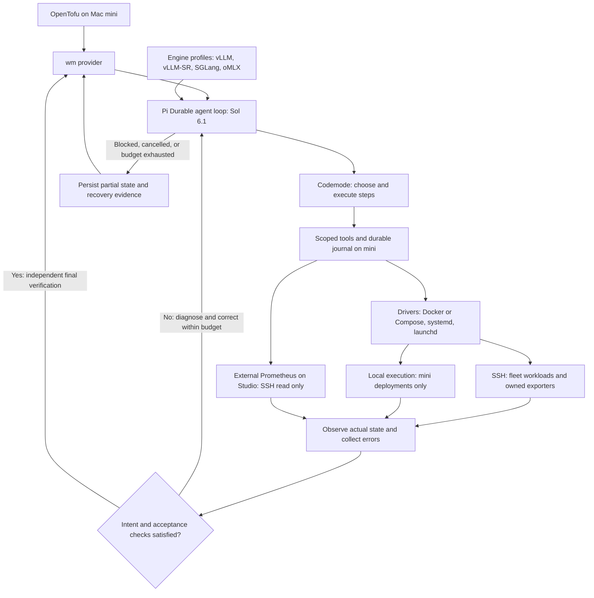

# Pi + codemode as the workload reconciliation runtime

> Implementation note: this design includes future capabilities. See [current status](development.md) for implemented behavior. Deployment audit records are kept outside public docs.

**Status:** Proposed refinement of the [OpenTofu agent spec](workload-manager-opentofu-agent-spec.md)

## Recommendation

Use Pi to host the Sol 6.1 agent, with codemode as its orchestration interface. Keep the OpenTofu provider small and retain the deterministic execution/verification boundary. This replaces the proposal to build our own Responses API agent loop.



The HCL remains unchanged. Pi is an implementation choice inside the provider's reconciliation path, not another user-facing declarative layer.

## What Pi Durable supplies

Use `@earendil-works/pi-durable` with `@earendil-works/pi-durable/codemode` and the QuickJS sandbox from `@earendil-works/pi-codemode`. This supersedes the earlier regular coding-agent SDK integration. Durable codemode resumes scripts using recorded nested tool results; an interrupted external action still needs idempotency and remote observation. Only mark tools replay-safe when that contract is implemented. Pin versions and test interrupted SSH operations. [Pi Durable documentation](https://github.com/earendil-works/pi/blob/main/packages/durable/README.md#code-mode)

Reuse Durable's conversation/task persistence; retain workload manifests and remote operation receipts for facts outside the harness. Completed or replayed tool results are evidence of their original observation time, not fresh actual state.

## Small implementation

Ship two executables:

- `terraform-provider-wm`: Go provider implementing OpenTofu semantics, read-only observation, operation authorization and final state handling.
- `wm-agent`: TypeScript runner embedding Pi Durable, invoked for one reconciliation operation, running repeated observe/act/verify/recover turns until convergence or a terminal outcome, then exiting.

Use a private local pipe/socket for structured messages. The provider sends the immutable plan contract, operation ID, prior recipe and observation references. The runner streams progress and tool requests. stdout is protocol-only; diagnostics go to stderr. The final response contains outcome, recipe digest and evidence references, not an authoritative assertion that state converged.

Register only workload tools in this dedicated session. Disable ambient discovery of user extensions, project instructions and unrelated tools; configure the model explicitly as Sol 6.1. Verify the pinned Pi model adapter can actually invoke it during prototype setup. Do not silently fall back to another model.

For v0.1, register custom tools directly; MCP is optional packaging if we later want the same tool service available to other clients. Avoid adding a permanent MCP daemon solely to connect two local components.

Pi owns the active reconciliation loop. The broker handles authority and receipts. Verification failures return to that loop as actionable evidence; the provider reports success only after independent checks pass.

## Model authentication on the control host

The prototype can reuse the control host's existing Codex ChatGPT file-based
sign-in through Pi's `openai-codex` provider with `gpt-6.1-sol`. This path was
verified with a live model request. `WM_MODEL_AUTH=codex` selects it explicitly;
`api` requires `OPENAI_API_KEY`, and `auto` prefers an existing API key and
otherwise uses Codex. This changes authentication/model transport, not the Pi
Durable agent loop or scoped codemode tools.

Read the access token on demand from the Codex credential store; never include
it in HCL, recipes, model context, receipts or operation databases. Codex owns
token refresh. The initial bridge supports file storage only, requires at least
35 minutes of remaining validity and fails with a refresh instruction rather
than rotating or copying refresh tokens. Remote workload hosts need SSH access,
not model credentials; the Mac mini's own sign-in will be used when it becomes
the control host.

## Drivers and engine profiles

The agent uses three independent concepts, defined in [the provider spec](workload-manager-opentofu-agent-spec.md#41-driver-engine-and-transport):

- **Driver:** `docker` (including Compose), `systemd` or `launchd`; deterministic ownership, lifecycle, observation and logs.
- **Engine:** optional versioned serving/routing knowledge and probes, such as `vllm`, `vllm-sr`, `sglang` or `omlx`. Ordinary applications/exporters need no engine.
- **Transport:** SSH to fleet hosts; local execution only on mini.

Explicit selections and pinned recipes constrain the agent. Exploratory selection resolves to recorded recipe/state outputs and is reused on subsequent operations. Changing the selection after convergence requires a new declared change. Sol can adapt permitted implementation details, but cannot bypass the driver broker or change lifecycle ownership during a repair. Each process has exactly one supervisor owner; additional backends may observe it.

Engine profiles guide reasoning and functional verification; drivers perform process mutations. Routing engines verify upstream routing rather than requiring weights. systemd and launchd integration must validate manager/domain identity and privileges over SSH before managing native services.

Engine mode belongs to the pinned recipe and determines the acceptance contract. `vllm-sr` can also serve a model: d3 uses `kind = "model"`, Docker lifecycle ownership and a vLLM-SR Engine-mode profile with model identity and inference checks. Do not infer routing-only behavior or an OpenAI-compatible endpoint from the engine name. A driver reporting `running` is only one observation; the agent continues until the workload's functional gates are verified or the operation reaches an explicit failure/budget boundary.

## Control host and transport

The **Mac mini** runs OpenTofu, the provider, Pi runner, credentials, recipe store and durable operation journal. It is distinct from the Mac Studio. Inventory must include `mini` and `studio` as separate identities; mini hardware capacity and SSH destinations remain to be verified before implementation.

All operations against arm-01, arm-02, gpu-01 and Studio execute remotely over SSH, including inspection, file staging, launch, logs and target-side probes. Local execution is allowed only when the deployment explicitly names `mini`. Resolve transport from verified inventory identity, never from the agent's guess or a path that happens to exist locally. Target paths are remote paths; mini artifact paths are staging paths.

Keep endpoint acceptance explicit: a target-side probe verifies the server locally, while a mini-side connectivity probe verifies the endpoint is usable from the control host. Use an SSH tunnel where appropriate rather than assuming every API is directly exposed. Artifact copies may stream through mini initially; direct peer transfer is an explicit later optimization.

Existing Prometheus/Grafana remain on Studio until a separate migration is requested. Query that setup read-only over SSH from mini; do not interpret local journal placement as a monitoring migration. Losing mini interrupts management, not existing remote serving.

## Docker applications and protected infrastructure

The same Durable agent loop manages `kind = "application"` workloads: a container or Compose stack on Studio, reached over SSH from mini. See [application scope and lifecycle](workload-manager-opentofu-agent-spec.md#31-docker-applications-are-first-class-workloads) for the proposed schema and acceptance gates. Models retain inference checks; applications use dependency readiness and functional probes. Agentic repair targets the smallest failing owned scope and preserves persistent data; database migrations cannot be undone merely by rolling back an image.

Prometheus and Grafana servers, central monitoring configuration/storage and shared monitoring networks are **external and protected**. Exporters are eligible for independent wm ownership as application workloads. Recover an exporter through SSH, runtime inspection and direct `/metrics`/collector checks without requiring Prometheus. Its observed application is not automatically in the exporter's mutation scope.

Executor checks must distinguish an owned exporter from protected objects in the same Compose project. If an exporter shares a Prometheus Compose project, allow only validated service-scoped operations, never project-wide teardown, dependency expansion or edits to shared configuration. See [exporter lifecycle rules](workload-manager-opentofu-agent-spec.md#external-prometheus-wm-managed-exporters). Scrape-target/rule changes stay in the separate ops workflow. Colima remains an external host prerequisite.

## Reconcile until intent is reached

The operation is an iterative agent loop, not a one-shot launch followed by pass/fail:

1. **Observe:** fetch the operation journal, live handles, runtime identities and fresh probes on every affected host, plus timestamped Prometheus snapshots and trends.
2. **Compare:** identify exact discrepancies against the immutable desired state and acceptance criteria.
3. **Decide:** Sol selects the next corrective action from current evidence and previous attempts.
4. **Act:** codemode invokes scoped tools; journal each underlying mutation and result.
5. **Verify:** measure the resulting state. Feed errors and unmet requirements back to Sol; repeat until all requirements pass.
6. **Commit:** provider independently checks the final evidence and writes OpenTofu state. If this last check detects a race or failure, return it to the same loop rather than declaring success.

A shell error, failed inference probe, incomplete download, rank startup failure or recoverable configuration issue normally becomes another agent turn. Sol may inspect logs, repair a bundle, resume transfer, alter implementation flags or restart the owned group within the approved contract. It must preserve the requested model/revision, capabilities, host set and disruption policy. An OOM may justify a different implementation or cache allocation, but not silently reducing required context or concurrency.

Transient SSH loss triggers bounded reconnection and observation of existing step handles. It never licenses a duplicate start or stopping an unknown peer. Script/session failure resumes from the durable journal and freshly observed state; unsuccessful attempts remain available to prevent repeating the same ineffective repair.

Termination is explicit: `Converged`, `Blocked` (requires new authority or unavailable prerequisite), `BudgetExceeded`, `Cancelled`, or `RecoveryRequired`. Consecutive equivalent failures without new evidence consume a configurable no-progress budget. Polling a confirmed live job is waiting, not a failed repair, but still consumes the wall-clock deadline. Error diagnostics identify the unmet intent, attempts, live processes and suggested next action.

Rollback is one possible recovery action, not the default response to every error. The agent can restore service, diagnose, and retry the target while the approved downtime/retry budget allows. Restoring the source alone is not convergence to a different requested target. If the LLM is unavailable, retain the deterministic single-attempt emergency rollback path from the parent spec.

This loop runs throughout each apply/recovery operation. Automatic repair after a completed apply is a separate optional watch mode: detect drift, create an explicit plan and apply under a predefined policy. It must not silently mutate outside OpenTofu's operation and locking model.

## How codemode helps this fleet

The agent can inspect both Sparks in one round trip, compare runtime images and mounts, and return only differences relevant to distributed startup. On the 5090 it can filter historical containers and logs rather than loading every tuning attempt into its context. On the Studio it can inspect an oMLX installation over SSH and summarize compatibility gaps.

Illustrative script using **proposed wm tools**, not existing Pi APIs:

```javascript
const hosts = ["arm-01", "arm-02"];
const results = await Promise.allSettled(
  hosts.map(host => tools.wm_inspect({ host }))
);
return results.map((result, i) => ({
  host: hosts[i],
  observation: result.status === "fulfilled" ? result.value : null,
  error: result.status === "rejected" ? String(result.reason) : null
}));
```

The broker attaches the authorized operation scope out of band. The script cannot grant itself access by supplying a different operation ID. Inspect results should be bounded typed records, with references for larger logs.

Use parallel scripts for independent inspection or staging. Use sequential steps for stop/start and route changes. The executor still enforces host-group locks even if the model accidentally launches conflicting calls concurrently.

## Actual state combines metrics, runtime evidence and probes

Prometheus is a first-class read-only input to every reconciliation cycle. It explains behavior over time; SSH establishes current process identity and ownership; functional probes establish the requested capability (inference for model workloads, application-specific checks for other services). No single source substitutes for all three.

| Evidence | What it establishes | What it cannot establish alone |
|---|---|---|
| SSH/runtime inspection | Exact container/process, image, mounts, ports, rank membership, exits | Successful inference or historical performance |
| Prometheus | Resource pressure, demand, latency, throughput, collector health and trends | Ownership, safe deletion or current readiness after a change |
| Active probes | Current model/API/capability behavior | Long-term stability or available capacity under heavier load |

The mini queries the existing Studio Prometheus through SSH: execute a bounded HTTP query against Studio's `127.0.0.1:9090`, or use a managed loopback SSH tunnel. Preserve its loopback binding. The inventory maps `studio` to the existing exporter label `node="mac"`; that label must never be interpreted as mini. Mini monitoring is a separate future target. Do not migrate monitoring or change scrape configuration as a side effect of reconciliation.

### Agent tools

Add three read-only tools, callable from durable codemode:

- `metrics_snapshot(workload, window)`: curated host/engine signals with freshness and coverage.
- `metrics_query(workload, expression, start, end, step)`: bounded PromQL for diagnosis, scoped by a parsed selector policy to the workload's mapped targets. Enforce timeout, maximum range, points and series; report truncation rather than silently treating partial results as complete.
- `metrics_targets(workload)`: target presence, scrape health, last scrape and collector errors.

Use Prometheus `/api/v1/query`, `/api/v1/query_range` and `/api/v1/targets`. Preserve API warnings and errors in tool results. Discovery uses the verified metric catalog and target labels; a missing metric is not permission to invent its value. [Prometheus HTTP API](https://prometheus.io/docs/prometheus/latest/querying/api/)

Each result includes query/expression, evaluation time, source sample timestamps or ages, window, target/label mapping, units, coverage, warnings and evidence ID. Derived-expression evaluation timestamps do not establish source freshness: explicitly inspect timestamps of required source series and scrape metadata. Classify observations as fresh, stale, missing, unsupported or error. Never coerce missing, NaN or insufficient observations to zero.

PromQL can select older samples within its lookback period, and stale series disappear; therefore a returned sample is not inherently current. [Prometheus query semantics](https://prometheus.io/docs/prometheus/latest/querying/basics/)

### Example diagnostic signals

Discover scrape intervals and metric semantics from the deployed configuration.
A freshness threshold can begin at two scrape intervals plus 15 seconds, but it
must reflect actual targets. Use current SSH/probes immediately after a mutation;
polling Prometheus faster cannot create new samples.

Useful signals include target/collector success, available host memory, GPU memory
pressure, queue depth, token throughput, cache occupancy, preemptions and latency.
Verify units and whether each series is a counter or gauge. Empty idle histograms
mean no observations, not zero latency. Public selectors below are illustrative:

```promql
node_memory_MemAvailable_bytes{job="node",node=~"arm-01|arm-02"}
vllm:num_requests_waiting{job="vllm",instance="arm-01:8888"}
rate(vllm:generation_tokens_total{job="vllm",instance="arm-01:8888"}[5m])
increase(vllm:num_preemptions_total{job="vllm",instance="arm-01:8888"}[5m])
```

### How metrics change the agent's decisions

Capture a pre-change baseline, inspect recent trends during recovery, and collect post-change evidence. Correlate each window with runtime ID/start time and the operation timeline. An endpoint reused for a different model must not blend the old deployment's history into the new one's acceptance evidence. Counter resets and model label changes remain explicit.

- Queue growth plus continuing token throughput suggests load: inspect concurrency and latency before restarting a productive server.
- Queue growth with stalled throughput suggests a possible stall: verify current runtime/logs and run a bounded probe before choosing repair.
- High cache occupancy and rising preemptions suggest pressure: Sol can adjust implementation within the declared context/concurrency requirements, then measure again.
- `up=0` with successful direct inference suggests a monitoring path problem. Do not restart the healthy model to fix a scrape.
- High memory usage on a loaded Spark is not itself failure; compare headroom, pressure and recent errors. Low GPU utilization may simply mean idle.

Metrics guide hypotheses, not autonomous permission. Every destructive correction still requires current SSH ownership checks and the approved change contract. Prometheus unavailability produces degraded observability; continue safe inspection and direct probes. If a declared acceptance criterion depends on unavailable telemetry, report that criterion unverified rather than claiming convergence.

Define acceptance against requested behavior, not arbitrary utilization thresholds. Default readiness requires direct inference and correct model identity; an optional stabilization window can require fresh scrapes and no observed restart/error regression. Latency/throughput acceptance requires a declared test load and sufficient observations. Store both verified capabilities and telemetry coverage in the final report.

### Durable replay and tests

A metrics response replayed by Pi Durable is historical evidence. After resumption, issue a new observation step with a new observation ID/time before deciding a corrective mutation. Preserve operation IDs for idempotent mutations; do not reuse an old metrics result as a fresh read.

Add tests for stale-but-present samples, missing collectors, Prometheus unavailable with healthy serving, overloaded-but-progressing queues, idle histograms, model swaps on the same port, counter resets and resumed sessions with old snapshots. Demonstrate that none causes an unjustified restart or false convergence. Query the real Prometheus schema during prototype validation; these document edits do not deploy collectors or alert rules.

### Application-specific actual state

Add service-level runtime identity, Docker health/restart/OOM evidence, memory limits and pressure, dependency readiness and declared functional checks. Existing Langfuse infrastructure metrics can explain a failure but do not prove trace ingestion. Application queue/latency signals require verified metric mappings; do not assume every container has a metrics endpoint. A missing external dependency or monitoring failure is not authorization to manage it. Stateful repair needs migration and data-retention evidence as described in the parent spec.

## Tools should remain useful primitives

Start with `inspect`, `read_bundle`, `logs`, `stage_artifact`, `write_bundle`, `start_step`, `poll_step`, `probe`, `metrics_snapshot`, `metrics_query`, and `metrics_targets`.

Sol can write a launch recipe and adapt engine flags. Avoid a giant `reconcile_everything` tool that hides all decisions, and avoid unrestricted SSH bash that bypasses ownership controls. A generated shell script needs an explicit execution scope; QuickJS isolation does not constrain what an exposed remote shell can do.

The executor validates hosts, runtime ownership, allowed paths and process/network permissions. Script execution on the remote host needs a constrained executor or an explicitly documented trusted-operator mode. Permission claims must match what is technically enforced.

A successful JavaScript promise is not necessarily a successful command. Normalize custom tool results into typed success/failure records and require exit status checks. If MCP is added, normalize its error envelopes too.

## Long tasks and interrupted runs

Weight copies, image preparation and model loading should return durable job handles promptly. A later bounded `poll_step` call observes the same job. Do not keep a codemode script open for a 45-minute startup or rely on a detached promise to keep work alive.

The journal records each step before execution, its idempotency key, runtime IDs, progress and completion. Pi session history is useful debugging context; it is never the source of truth about whether a container was created.

Example failure: a script starts rank 0, then throws before recording its local summary. The next agent turn must query the journal and Docker before retrying. Re-running the script blindly could create a duplicate or stop a healthy process.

Provider cancellation revokes permission for new steps. The executor tracks and explicitly cancels or finishes already-started jobs according to their contract. Killing Pi does not prove a remote process stopped. Recovery begins by observing those job handles and runtimes, then either resumes or performs the saved rollback procedure.

Count actual underlying tool invocations against budgets, not just codemode calls: one script can request many actions. Also bound concurrency, output, agent turns, tokens and total elapsed time. Record tool evidence before filtering results for the model, so an omitted failure remains visible in the operation record.

## Preserve the OpenTofu boundary

Plan and Read use deterministic tools without a Pi session. Apply invokes Pi only when a change or verified repair requires it. Pi cannot modify HCL, OpenTofu state, the approved model revision or permitted hosts.

When Pi proposes completion, the provider checks live identity and required inference/capability probes. Failed checks return structured discrepancies to Pi for another corrective turn while the operation remains authorized and within budget. It reports failure only at a terminal boundary, including when rollback restored service but the requested target remains unmet. Agent narration cannot substitute for evidence.

No continuous background agent is needed. Docker/native supervisors keep serving after apply; existing Prometheus/Grafana monitoring surfaces failures between applies.

## First experiment

Build the runner independently of OpenTofu first, using a saved operation-contract fixture and a fake executor. Prove tool registration, Sol access, cancellation and output normalization before adding real mutations.

Then test on the idle 5090:

1. Read-only inventory through codemode.
2. One pinned model launch and independent inference probe.
3. Resume after script failure following a successful start; no duplicate process.
4. Cancel during a long job; journal and live runtime agree on its fate.
5. Attempt an out-of-scope host or unowned exporter stop; broker rejects it. Repair an owned exporter with Prometheus unavailable and verify the observed application remains untouched.
6. Repeat an already-converged operation with no model call or restart.
7. Inject a bad launch flag and a failed inference check; the loop diagnoses, corrects and reaches the declared outcome without manual intervention.
8. Run from mini and verify that every non-mini action uses SSH, including Studio deployment; only a mini deployment may use local execution.
9. Connect the same runner to provider Create/Update and exercise saved-plan and partial-state tests.

This is a design recommendation, not a claim that Pi is installed or that these integration tests have passed. The main experiment is whether Pi removes agent-loop plumbing while the small deterministic kernel remains easy to reason about.
